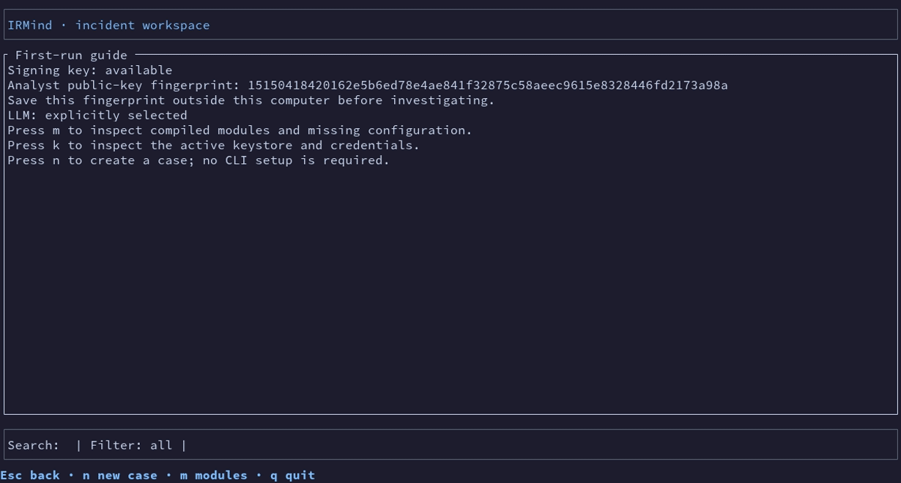

Traducción de README.md en el commit 08172a83df22ec719c7f9a7fbe83c064fc5e9229; si hay diferencias, prevalece la versión en inglés.

# IRMind — Respuesta asistida a incidentes

Cliente de IA en terminal para investigaciones de seguridad, con llamadas a herramientas sujetas a política y cadena de custodia firmada.



*Esta demostración sin conexión usa evidencia sintética, un llavero de archivo efímero y un modelo falso.*

> [!WARNING]
> IRMind está en desarrollo. Todavía no lo uses con incidentes reales ni datos sensibles.
> Los ejemplos de este repositorio son sintéticos.

## Qué puedes hacer

- Abrir un caso, definir su alcance e investigar una alerta desde la terminal.
- Ingerir evidencia local y consultar la cronología y el grafo de entidades.
- Pedir a un modelo seleccionado que proponga consultas de investigación.
- Revisar y firmar aprobaciones antes de un enriquecimiento externo.
- Consultar registros indexados y originales disponibles mientras el modelo recibe datos limitados y redactados.
- Verificar, sellar, exportar y volver a verificar un paquete de caso.

## Cómo funciona

El modelo propone una llamada. La política comprueba la herramienta, los argumentos, el alcance del caso, el modo de ejecución y los límites. Los conectores autorizados devuelven evidencia que permanece en local; el modelo ve una copia protegida. La auditoría firmada registra propuestas, decisiones, resultados y cambios del caso.

```text
Analista → TUI → caso + política → conector autorizado → evidencia local
                  ↑       ↓
                modelo  cadena de auditoría firmada
```

Consulta el [modelo de seguridad](docs/es/security-model.md) para conocer las garantías y límites.

## Instalación

Para una evaluación interna, se recomienda compilar desde el código:

```sh
rustup toolchain install 1.95.0
cargo build --release --locked -p irmind
./target/release/irmind
```

Todavía no hay binarios publicados como versión. CI genera artefactos sin firma solo para tags de versión y ejecuciones nocturnas tras cambios de código. Verifica `SHA256SUMS` antes de ejecutarlos. La [guía de plataformas](docs/es/platforms.md) explica las comprobaciones, los almacenes de claves y el uso por SSH.

## Primer caso en la TUI

1. Ejecuta `irmind` sin subcomando. Elige los backends de firma y secretos con las flechas y Enter; si usas el almacén de archivo, introduce y confirma la passphrase en campos enmascarados. Funciona por SSH. Guarda la huella de la clave del analista fuera del equipo. Puedes omitir el paso opcional «Modelo de IA».
2. En el inicio, escribe texto para filtrar títulos o usa `/cases open|sealed|inconsistent` para filtrar por estado. Escribe `/new`, indica un título y elige la severidad; Enter crea un caso local. El segundo paso permite añadir un alcance remoto y una ventana UTC.
3. Abre el caso y escribe `/ingest`. Selecciona [examples/cloudtrail-alert.json](examples/cloudtrail-alert.json), que contiene únicamente datos sintéticos. IRMind calcula el hash en su ubicación; copiar el original es una opción explícita.
4. Escribe `/model` para elegir Ollama, un servicio compatible con OpenAI, Anthropic, DeepSeek u OpenRouter. Ollama lista los modelos instalados en `http://127.0.0.1:11434`; las claves remotas se guardan en el backend de secretos. «Probar conexión» solo envía texto sintético. Confirma explícitamente la salida de datos para un proveedor remoto. La sesión se recarga dentro de la TUI.
5. Abre de nuevo el caso y describe la alerta sintética. Enter envía. Escribe `/` para ver comandos, `Ctrl+K` para abrir la paleta, `/sidebar` para los paneles y `Ctrl+O` para desplegar una tarjeta seleccionada. PgUp/PgDn desplazan la vista. En una aprobación, usa flechas y Enter o escribe su número seguido de Enter. `/pause` o Esc cancela una tarea activa.
6. Revisa la cronología y los registros indexados. Usa `/verify <directorio-origen>`, `/report`, `/seal` y `/export`. El sellado y la exportación muestran el hash y la huella de la clave antes de confirmar.

Ningún LLM está habilitado por defecto. Puedes ingerir y verificar evidencia local sin uno.
En los siguientes arranques, IRMind verifica y reabre el último caso abierto que usaste. Usa `/home` para volver a la lista o `/config` para desactivar esta opción.

## Módulos

La compilación normal incluye todos los módulos de producto actuales y ambos llaveros. Ninguno se activa hasta seleccionarlo y configurarlo. Una compilación mínima usa `--no-default-features --features keystore-file` porque siempre se necesita firma y un backend de secretos. Todos siguen siendo experimentales.

| Módulo | Tipo | Feature | Estado | Configuración |
| --- | --- | --- | --- | --- |
| Compatible con OpenAI y Ollama local | LLM | incluida | experimental | [Módulos](docs/es/modules.md) |
| Anthropic | LLM | `llm-anthropic` | experimental | [Módulos](docs/es/modules.md) |
| DeepSeek | LLM | `llm-deepseek` | experimental | [Módulos](docs/es/modules.md) |
| OpenRouter | LLM | `llm-openrouter` | experimental | [Módulos](docs/es/modules.md) |
| Splunk | SIEM | `siem-splunk` | experimental | [Módulos](docs/es/modules.md) |
| AWS CloudTrail e IAM | nube | `cloud-aws` | experimental | [Módulos](docs/es/modules.md) |
| Almacenamiento S3 | almacenamiento en nube | `storage-s3` | experimental | [Objetos](docs/es/modules.md#almacenamiento-de-objetos-en-la-nube-s3-gcs-y-azure-blob) |
| Almacenamiento GCS | almacenamiento en nube | `storage-gcs` | experimental | [Objetos](docs/es/modules.md#almacenamiento-de-objetos-en-la-nube-s3-gcs-y-azure-blob) |
| Almacenamiento Azure Blob | almacenamiento en nube | `storage-azure` | experimental | [Objetos](docs/es/modules.md#almacenamiento-de-objetos-en-la-nube-s3-gcs-y-azure-blob) |
| Objetos S3 | almacenamiento en la nube | `storage-s3` | experimental | [Módulos](docs/es/modules.md) |
| Objetos GCS | almacenamiento en la nube | `storage-gcs` | experimental | [Módulos](docs/es/modules.md) |
| Azure Blob | almacenamiento en la nube | `storage-azure` | experimental | [Módulos](docs/es/modules.md) |
| CrowdStrike | EDR | `edr-crowdstrike` | experimental | [Módulos](docs/es/modules.md) |
| SentinelOne | EDR | `edr-sentinelone` | experimental | [Módulos](docs/es/modules.md) |
| MISP | TI interna | `ti-misp` | experimental | [Módulos](docs/es/modules.md) |
| VirusTotal | enriquecimiento externo | `ti-virustotal` | experimental | [Módulos](docs/es/modules.md) |
| Parser JSON y logs de nube exportados | parser local | incluido | experimental | [Módulos](docs/es/modules.md) |
| Llavero del sistema | firma y secretos | `keystore-os` (por defecto) | experimental | [Módulos](docs/es/modules.md#llavero-del-sistema) |
| Archivo cifrado | firma y secretos | `keystore-file` (por defecto) | experimental | [Módulos](docs/es/modules.md#archivo-cifrado) |

## Seguridad

- Los puertos externos solo aceptan llamadas autorizadas; el modo desatendido solo permite lecturas dentro del alcance.
- El enriquecimiento externo necesita una aprobación firmada del analista; la contención está deshabilitada.
- La evidencia original queda en local; el contexto del modelo se limita, protege y redacta.
- La auditoría se encadena por hash y se firma; un paquete sellado se puede comprobar en otro equipo. Las migraciones de llavero entran en una cadena global firmada.
- La redacción puede pasar datos por alto. Un firmante local puede reescribir una cadena completa si su huella no está fijada fuera del equipo. Esta versión no es apta para producción.

Lee [security-model.md](docs/es/security-model.md) antes de conectar un proveedor.

## Más información

- [Inicio](docs/es/getting-started.md) · [Configuración](docs/es/configuration.md) · [Módulos](docs/es/modules.md)
- [Plataformas](docs/es/platforms.md) · [Seguridad](docs/es/security-model.md)
- [Arquitectura](docs/development/architecture.md) y [CLI](docs/development/cli.md), solo en inglés
- [Hoja de ruta](docs/es/roadmap.md)
- [Contribuciones](CONTRIBUTING.md) · [Reporte privado de vulnerabilidades](SECURITY.md) · [Licencias](LICENSE-MIT)

Licencia dual **MIT OR Apache-2.0**; consulta [LICENSE-MIT](LICENSE-MIT) y [LICENSE-APACHE](LICENSE-APACHE).
