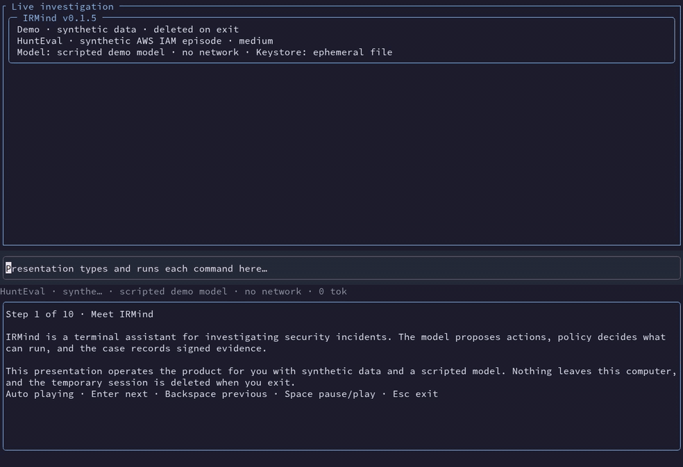

Traducción de README.md en el commit f77a5de8c3bbc86a3c06078bd97fc13385651fea; si hay diferencias, prevalece la versión en inglés.

# IRMind — Respuesta asistida a incidentes

Cliente de IA en terminal para investigaciones de seguridad, con llamadas a herramientas sujetas a política y cadena de custodia firmada.

IRMind es un asistente agéntico de terminal para respuesta a incidentes y análisis forense: el analista conversa con un agente que investiga evidencia local y remota, carga skills forenses cuando hacen falta y delega trabajo acotado en subagentes paralelos. El modelo propone, la política decide y todo queda firmado.



*La presentación completa usa el producto real con evidencia sintética, claves efímeras y un modelo guionizado sin red. Enter avanza; Espacio pausa; Esc sale.*

> [!WARNING]
> IRMind 0.4.1 es una versión preliminar para evaluar con datos sintéticos. El analista aceptó H5 tras probar un saludo con DeepSeek real; siguen pendientes de registro los demás pasos y la validación de un conector real. No la uses para incidentes reales ni datos sensibles.

> [!WARNING]
> Antes de 1.0, cada versión menor puede cambiar los formatos de casos, exportaciones y definiciones sin migración. Conserva la versión de IRMind que creó un caso para abrirlo, verificarlo o exportarlo, o reingiere los originales verificados en un caso nuevo.

## Qué puedes hacer

- Abrir un caso, definir su alcance e investigar una alerta desde la terminal.
- Ingerir evidencia local y consultar la cronología y el grafo de entidades.
- Pedir a un modelo seleccionado que proponga consultas de investigación.
- Revisar y firmar aprobaciones antes de un enriquecimiento externo.
- Consultar registros indexados y originales disponibles mientras el modelo recibe datos limitados y redactados.
- Verificar, sellar, exportar y volver a verificar un paquete de caso.

## Cómo funciona

El modelo propone una llamada. La política comprueba la herramienta, los argumentos, el alcance del caso, el modo de ejecución y los límites. Los conectores autorizados devuelven evidencia que permanece en local; el modelo ve una copia protegida. La auditoría firmada registra propuestas, decisiones, resultados y cambios del caso.

```text
Analista → TUI → caso + política → conector autorizado → evidencia local
                  ↑       ↓
                modelo  cadena de auditoría firmada
```

Consulta el [modelo de seguridad](docs/es/security-model.md) para conocer las garantías y límites.

## Instalación

Para una evaluación interna, se recomienda compilar desde el código:

```sh
rustup toolchain install 1.95.0
cargo build --release --locked -p irmind
./target/release/irmind
```

La [versión preliminar v0.4.1](https://github.com/ns2switch/irmind/releases/tag/v0.4.1) ofrece bundles Sigstore sin claves permanentes, procedencia de GitHub, un SBOM y hashes. Descarga el binario y `SHA256SUMS`, verifica sus hashes y la identidad exacta del firmante con cosign 3.1.3 o posterior y comprueba `gh attestation verify`. La [guía de plataformas](docs/es/platforms.md) da los comandos. Tras verificar una copia descargada de [install.sh](install.sh) o [install.ps1](install.ps1), el instalador puede hacer esas comprobaciones.

Usa la versión menor que creó el caso para volver a abrirlo. La [política de versiones](docs/development/decisions.md#pre-10-format-policy) explica cómo conservar el ejecutable o reingerir los originales verificados.

```sh
# Tras descargar el binario, SHA256SUMS y ambos bundles .sigstore.json:
tag=v0.4.1; binary=irmind-linux-x86_64
for file in "$binary" SHA256SUMS; do
  cosign verify-blob "$file" --bundle "$file.sigstore.json" --certificate-identity "https://github.com/ns2switch/irmind/.github/workflows/ci.yml@refs/tags/$tag" --certificate-oidc-issuer https://token.actions.githubusercontent.com
done
awk -v name="$binary" '$2 == name { print }' SHA256SUMS | sha256sum -c -
gh attestation verify "$binary" -R ns2switch/irmind
```

## Pruébalo en cinco minutos

Ejecuta `irmind demo` o escribe `/demo` en el inicio. El producto teclea comandos y realiza una investigación de diez pasos por ti. Un panel de narración grande explica la evidencia, las consultas locales, la respuesta en streaming, la aprobación firmada y las comprobaciones de custodia. No necesitas clave de API, passphrase, cuenta ni red. El caso temporal aislado y las claves se borran al salir.

Usa **Enter** para avanzar, **Retroceso** para revisar un paso, **Espacio** para pausar o reanudar y **Esc** para salir. La demo admite **80 × 24 celdas**; se recomiendan **100 × 40**. PgUp/PgDn desplaza la narración compacta y pausa la reproducción. La consulta externa simulada pasa por la política y se aprueba con la clave temporal del analista; no sale ninguna petición del equipo. Al terminar puedes explorar el caso sellado, aprender a crear uno propio o salir. La [guía de primeros pasos](docs/es/getting-started.md#pruébalo-en-cinco-minutos) muestra las diez escenas.

## Primer caso en la TUI

1. Ejecuta `irmind`. El asistente configura los backends de firma y secretos; si eliges el archivo cifrado, introduce y confirma la passphrase en campos enmascarados. Guarda la huella de la clave del analista fuera del equipo. Elige un modelo en el asistente o escribe `/settings model` después. Ningún modelo está seleccionado por defecto.
2. Escribe `/new`, introduce un título y elige la severidad con las flechas. Enter crea un caso local; el segundo paso del formulario permite añadir un alcance remoto opcional.
3. En el caso, escribe `/ingest` y selecciona [el ejemplo sintético de CloudTrail](examples/cloudtrail-alert.json). IRMind calcula su hash en la ubicación original; la copia es opcional y explícita.
4. Pregunta qué sugiere la asunción de rol sintética y pulsa Enter. La respuesta aparece de forma incremental. También puedes conversar sin iniciar una investigación.
5. Revisa la llamada propuesta. Una consulta externa espera una aprobación firmada; elige una opción numerada con las flechas y Enter. Escribe `/` para ver comandos, `Ctrl+K` para la paleta, `/pause` para cancelar o `/continue` después de un límite del modelo.
6. Usa `/verify <directorio-origen>` para comprobar el original; revisa `/report` antes de `/seal` y `/export`. Estas dos acciones muestran el hash del caso y la huella de la clave antes de confirmar.

Ningún LLM está habilitado por defecto. Puedes ingerir y verificar evidencia local sin uno.
En los siguientes arranques, IRMind verifica y reabre el último caso abierto que usaste. Usa `/home` para volver a la lista o `/settings preferences` para desactivar esta opción. `/settings` también reúne conectores, credenciales, ratón y tema. `/help` enumera los comandos y las teclas reservadas: Enter, Esc, flechas, Tab/Shift+Tab, PgUp/PgDn, Ctrl+C, Ctrl+K y Ctrl+O. Ctrl+O o `/expand` despliega o pliega la tarjeta seleccionada o la última plegable sin salir del campo de entrada. Los caracteres imprimibles, incluido `/`, se escriben en el campo de formulario que tiene el foco; el pegado también funciona allí.

Usa `/skills` para inspeccionar y gestionar los 15 métodos incluidos de nube, Windows, Linux, red y Kubernetes. Invoca `/windows-triage`, `/linux-triage` o `/aws-credential-compromise` dentro de un caso. El modelo los carga cuando hacen falta; no amplían permisos. Consulta la [guía de skills](docs/es/skills.md).

## Módulos

La versión 0.4 usa una única cadena decodificador de origen → mapeo identificado → escritor V3 en la CLI, la TUI y la demo. Solo lee los formatos actuales de caso y la exportación V7. [Los casos anteriores necesitan su versión creadora o una ingesta nueva](docs/development/case-migration.md).

La compilación normal incluye todos los módulos de producto actuales y ambos llaveros. Los modelos remotos y conectores permanecen desactivados hasta seleccionarlos y configurarlos. Los parsers locales se eligen por detección del contenido. Una compilación mínima usa `--no-default-features --features keystore-file` porque siempre se necesita firma y un backend de secretos. Todos siguen siendo experimentales.

`/settings model` también ofrece LM Studio y vLLM locales, y Mistral, Groq, Google Gemini, xAI y Together remotos. Usan el módulo compatible con OpenAI; consulta [URL y límites](docs/es/modules.md#compatible-con-openai).

| Módulo | Tipo | Feature | Estado | Configuración |
| --- | --- | --- | --- | --- |
| Compatible con OpenAI y Ollama local | LLM | incluida | experimental | [Módulos](docs/es/modules.md) |
| Anthropic | LLM | `llm-anthropic` | experimental | [Módulos](docs/es/modules.md) |
| DeepSeek | LLM | `llm-deepseek` | experimental | [Módulos](docs/es/modules.md) |
| OpenRouter | LLM | `llm-openrouter` | experimental | [Módulos](docs/es/modules.md) |
| Elastic | SIEM | `siem-elastic` | experimental | [Elastic](docs/es/modules.md#elasticsearch-y-elastic-security) |
| Google SecOps | SIEM | `siem-chronicle` | experimental | [Google SecOps](docs/es/modules.md#google-secops-chronicle) |
| Splunk | SIEM | `siem-splunk` | experimental | [Módulos](docs/es/modules.md) |
| AWS CloudTrail e IAM | nube | `cloud-aws` | experimental | [Módulos](docs/es/modules.md) |
| Almacenamiento S3 | almacenamiento en nube | `storage-s3` | experimental | [Objetos](docs/es/modules.md#almacenamiento-de-objetos-en-la-nube-s3-gcs-y-azure-blob) |
| Almacenamiento GCS | almacenamiento en nube | `storage-gcs` | experimental | [Objetos](docs/es/modules.md#almacenamiento-de-objetos-en-la-nube-s3-gcs-y-azure-blob) |
| Almacenamiento Azure Blob | almacenamiento en nube | `storage-azure` | experimental | [Objetos](docs/es/modules.md#almacenamiento-de-objetos-en-la-nube-s3-gcs-y-azure-blob) |
| CrowdStrike | EDR | `edr-crowdstrike` | experimental | [Módulos](docs/es/modules.md) |
| SentinelOne | EDR | `edr-sentinelone` | experimental | [Módulos](docs/es/modules.md) |
| MISP | TI interna | `ti-misp` | experimental | [Módulos](docs/es/modules.md) |
| VirusTotal | enriquecimiento externo | `ti-virustotal` | experimental | [Módulos](docs/es/modules.md) |
| Parser JSON y logs de nube exportados | parser local | `parser-json` (por defecto) | experimental | [Módulos](docs/es/modules.md) |
| Mapeo de eventos comunes de CloudTrail | mapeo local | `mapping-cloudtrail` | experimental | [Mapeos](docs/es/mappings.md) |
| Mapeo de eventos comunes Windows | mapeo local | `mapping-evtx` | experimental | [Mapeos](docs/es/mappings.md#registro-de-eventos-de-windows) |
| Mapeo de eventos comunes ECS | mapeo local | `mapping-ecs` | experimental | [Mapeos](docs/es/mappings.md) |
| Mapeo OCSF de eventos comunes | mapeo local | `mapping-ocsf` | experimental | [Mapeos](docs/es/mappings.md) |
| Parser de Elastic Common Schema | parser local | `parser-ecs` (por defecto) | experimental | [ECS](docs/es/modules.md#parser-de-elastic-common-schema) |
| Parser de OCSF JSON y Parquet | parser local | `parser-ocsf` (por defecto) | experimental | [OCSF](docs/es/modules.md#parser-de-ocsf) |
| Parser de Velociraptor | parser local | `parser-velociraptor` (por defecto) | experimental | [Velociraptor](docs/es/modules.md#parser-de-velociraptor) |
| Parser de Hayabusa | parser local | `parser-hayabusa` (por defecto) | experimental | [Hayabusa](docs/es/modules.md#parser-de-hayabusa) |
| Parser de Chainsaw | parser local | `parser-chainsaw` (por defecto) | experimental | [Chainsaw](docs/es/modules.md#parser-de-chainsaw) |
| Parser de plaso | parser local | `parser-plaso` (por defecto) | experimental | [plaso](docs/es/modules.md#parser-de-plaso) |
| Zeek | Parser | `parser-zeek` | experimental | [Configuración](docs/es/modules.md#parser-de-zeek) |
| Suricata EVE | Parser | `parser-suricata` | experimental | [Configuración](docs/es/modules.md#parser-de-suricata-eve) |
| Parser declarativo | parser local | `parser-declarative` (por defecto) | experimental | [Formatos propios](docs/es/parsers.md) |
| GCP Cloud Audit / GKE | parser y mapeo locales | `parser-gcp-audit` (por defecto) | experimental | [GCP y GKE](docs/es/parsers.md#cloud-audit-logs-de-gcp-y-gke) |
| Microsoft Entra ID | parser y mapeo locales | `parser-entra` (por defecto) | experimental | [Entra](docs/es/parsers.md#microsoft-entra-id) |
| Auditoría Kubernetes | parser y mapeo locales | `parser-kubernetes` (por defecto) | experimental | [Contexto de clúster](docs/es/parsers.md#interpretación-de-kubernetes-y-falco) |
| Falco | parser y mapeo locales | `parser-falco` (por defecto) | experimental | [Alertas de origen](docs/es/parsers.md#interpretación-de-kubernetes-y-falco) |
| Logs de Linux | parser local | `parser-linux` (por defecto) | experimental | [Linux](docs/es/modules.md#logs-de-linux) |
| Windows EVTX | parser local aislado | `parser-evtx` (por defecto) | experimental | [EVTX](docs/es/modules.md#windows-evtx) |
| Parser Syslog | parser local | `parser-syslog` (por defecto) | experimental | [Syslog](docs/es/modules.md#parser-syslog) |
| Parser de EZTools | parser local | `parser-eztools` (por defecto) | experimental | [EZTools](docs/es/modules.md#parser-de-eztools) |
| Llavero del sistema | firma y secretos | `keystore-os` (por defecto) | experimental | [Módulos](docs/es/modules.md#llavero-del-sistema) |
| Archivo cifrado | firma y secretos | `keystore-file` (por defecto) | experimental | [Módulos](docs/es/modules.md#archivo-cifrado) |

## Seguridad

- Los puertos externos solo aceptan llamadas autorizadas; el modo desatendido solo permite lecturas dentro del alcance.
- El enriquecimiento externo necesita una aprobación firmada del analista; la contención está deshabilitada.
- La evidencia original queda en local; el contexto del modelo se limita, protege y redacta.
- La auditoría se encadena por hash y se firma; un paquete sellado se puede comprobar en otro equipo. Las migraciones de llavero entran en una cadena global firmada.
- La redacción puede pasar datos por alto. Un firmante local puede reescribir una cadena completa si su huella no está fijada fuera del equipo. Esta versión no es apta para producción.

Lee [security-model.md](docs/es/security-model.md) antes de conectar un proveedor.

## Hoja de ruta

- **v0.1.x:** Estabilizar la versión preliminar, validar un modelo y un conector, y añadir firma nativa por plataforma.
- **v0.2 (entregada):** Parsers modulares, artefactos precisos y auxiliar EVTX aislado.
- **v0.3:** Eventos comunes tipados, decodificadores y mapeos separados, solo escritura V3, ingesta multinúcleo y conectores SIEM experimentales.
- **v0.4:** Añadir skills forenses firmadas y de carga progresiva.
- **v0.5:** Añadir subagentes paralelos acotados y eventos en streaming.
- **Lanzamiento público:** Publicar la demo, el benchmark y el catálogo inicial de skills.
- **v0.6:** Añadir consultas en origen con presupuestos.
- **v0.7:** Añadir detecciones locales, informes exportables, extensiones controladas y una API del motor.
- **1.0:** Estabilizar formatos firmados y completar revisiones externas de seguridad y conectores.

La [hoja de ruta pública](docs/es/roadmap.md) describe intenciones, sin compromisos de publicación.

## Más información

- [Inicio](docs/es/getting-started.md) · [Configuración](docs/es/configuration.md) · [Módulos](docs/es/modules.md)
- [Plataformas](docs/es/platforms.md) · [Seguridad](docs/es/security-model.md)
- [Arquitectura](docs/development/architecture.md) y [CLI](docs/development/cli.md), solo en inglés
- [Hoja de ruta](docs/es/roadmap.md)
- [Contribuciones](CONTRIBUTING.es.md) · [Código de conducta](CODE_OF_CONDUCT.es.md) · [Reporte privado de vulnerabilidades](SECURITY.md) · [Licencias](LICENSE-MIT)

Licencia dual **MIT OR Apache-2.0**; consulta [LICENSE-MIT](LICENSE-MIT) y [LICENSE-APACHE](LICENSE-APACHE).
