# Automatic demo presentation

This page is for maintainers reviewing the synthetic presentation. It describes the ten-scene live presentation and its isolation, navigation and test coverage.

## Script and playback

The versioned [English script](../../crates/tui/assets/demo-presentation.en.json) contains ten scene IDs, short titles, narration, commands and required completion events. Narration can change without rewriting the playback controller. Future translation follows [issue #146](https://github.com/ns2switch/irmind/issues/146); no locale implementation is included here.

The TUI types into its ordinary composer and dispatches the same registered commands as an analyst. It waits for actual work to complete and for the corresponding result event. Reading time scales with narration length, with a six-second minimum at normal speed. The development `--presentation-speed` option accelerates timing for PTY tests; it does not change policy or skip work.

Enter advances, Backspace goes back, Space pauses or resumes playback, and Esc/Ctrl+C cancels work and exits. Completed actions are retained when navigating back. The full-width narration stays below the transcript; 80 × 24 terminals use compact, scrollable narration with fixed controls and hidden secondary panels. PgUp/PgDn pauses playback to read. Below 80 × 24, a resize notice appears. The recommended size remains 100 × 40. Ordinary cases retain their existing smaller-terminal support.

The demo's composition root creates the signed temporary case before entering the presentation. Scene two explains that case and executes `/scope`; scene three visibly executes `/ingest events.json`. That exact alias is resolved to the bundled file inside the demo directory, then uses ordinary parser selection, ingestion and SourceManifestV2. Other paths remain rejected; no original is copied.

## Isolation and trust

Presentation playback requires the explicitly isolated demo workspace. Normal workspace and application port signatures stay unchanged. The added TUI entry point passes presentation timing through private presentation state, not a global variable.

The presentation always uses the scripted model and does not even probe loopback Ollama. The external-enrichment example uses the existing in-memory synthetic connector. It still goes through policy and signed approval with the temporary analyst key. Expected answers are loaded only by `/demo check`; narration and evaluation data never enter a model prompt.

The private temporary directory and ephemeral file keystore are deleted when the demo returns, including error and cancellation. Terminal restoration remains protected by the existing session guard. The SSH/GUI terminal matrix for Ctrl+O is documented separately in [platforms](../platforms.md#card-expansion-and-terminal-keymaps).

## Presentation previews

The real-binary PTY test reaches the ingestion result and checks parser confidence, exits with Esc, and checks both the existing real-data directory and temporary parent. The screenshots below use the reviewed, digest-pinned VHS image with network disabled, bounded container resources and fixed identity variables. They show the actual 0.1.5 development binary, not a mockup.

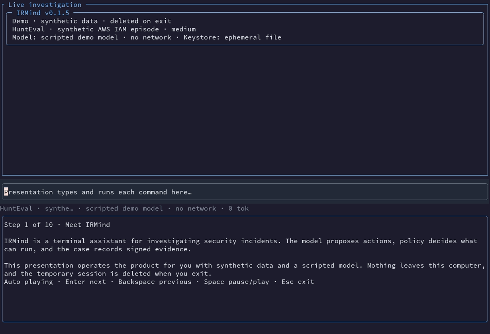

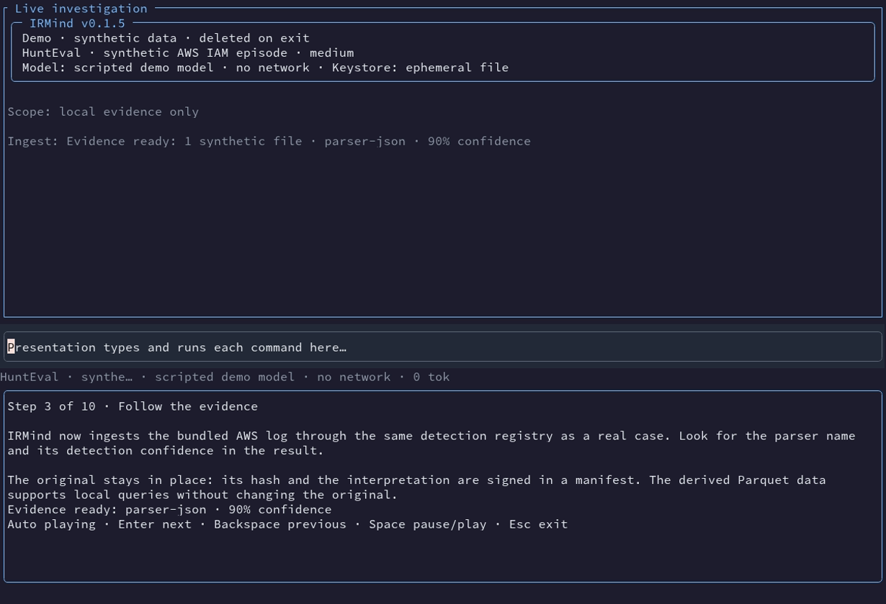

Reproduce with the [preview generator](../demo/generate_presentation_preview.py), passing the current development binary through its binary option; see the script help. The generator removes its scratch directory after capture or error. The finished recording uses [community.tape](../demo/community.tape); all ten scene screenshots are generated beside these previews.

## Complete presentation

The step controller never substitutes a screenshot for work. Scope, registry ingestion, timeline/search/neighbors, investigation, approval, finding confirmation, comparison, verify, seal, export and expected-key export verification use the existing command paths. The scripted model yields whitespace-preserving word chunks with cancellation and cites the real source hash. The enrichment connector is an offline fake; approval still resolves policy with a signed analyst decision. Seal/export show the ordinary exact confirmation previews before the demo selects Confirm. That selection is gated on the isolated demo workspace and the custody scene; normal cases never auto-approve.

The final screen offers read-only exploration of the sealed case, a short explanation of `/new`/`/ingest`/`/settings`, or exit. Space pauses action scheduling. Backspace cancels unsubmitted typing or waits for already-started work, then revisits narration without repeating committed actions. Presentation input cannot edit the real workspace or paste into an active command. Terminating at any scene cancels outstanding work, restores the terminal and removes the temporary tree.

Tests read each scene title from the versioned script and wait for that actual rendered screen with a bounded deadline. Automatic and manual PTYs execute all ten scenes, then check isolation and cleanup; a separate loop sends Ctrl+C at each scene. The same tests compile and run on Linux, macOS and Windows. TestBackend/insta cover the bottom panel and undersized-screen notice, while controller snapshots retain every narration. Native terminal applications and remote keymaps remain separate manual checks.

The full [README GIF](../assets/demo.gif) is generated from the current binary. The existing digest-pinned VHS image runs without network and receives only the binary and tape in a disposable directory. It checks the actual version, all ten scene/results, duration, size and fixed-identity privacy before publishing images. The manual regeneration workflow keeps its existing permissions and opens a PR with both the GIF and scene captures.

### Scene gallery

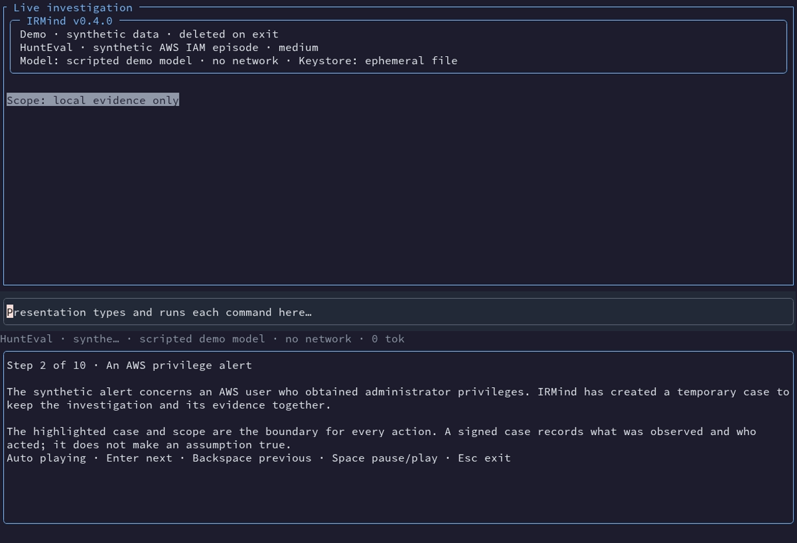
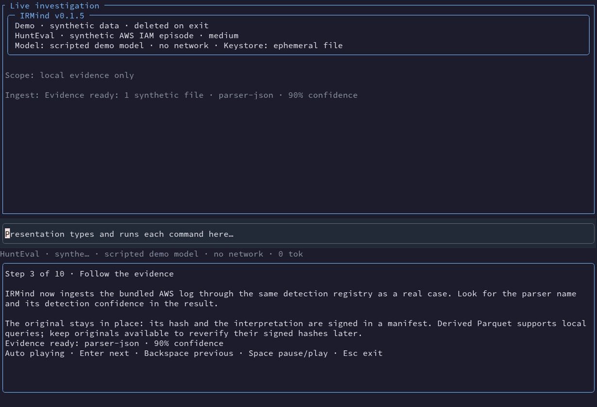
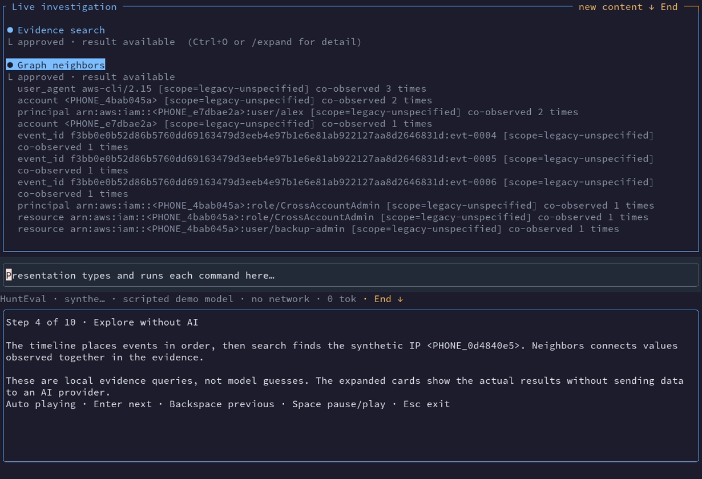
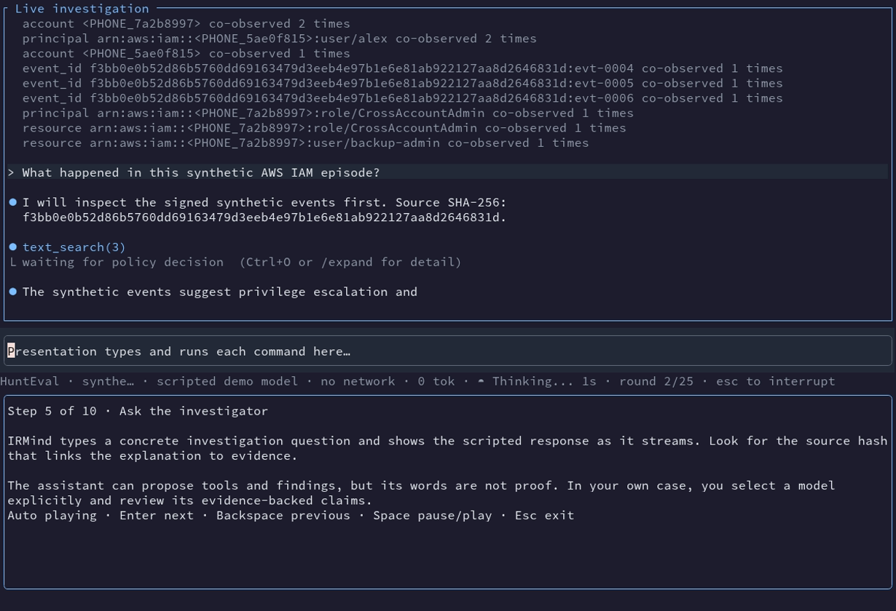
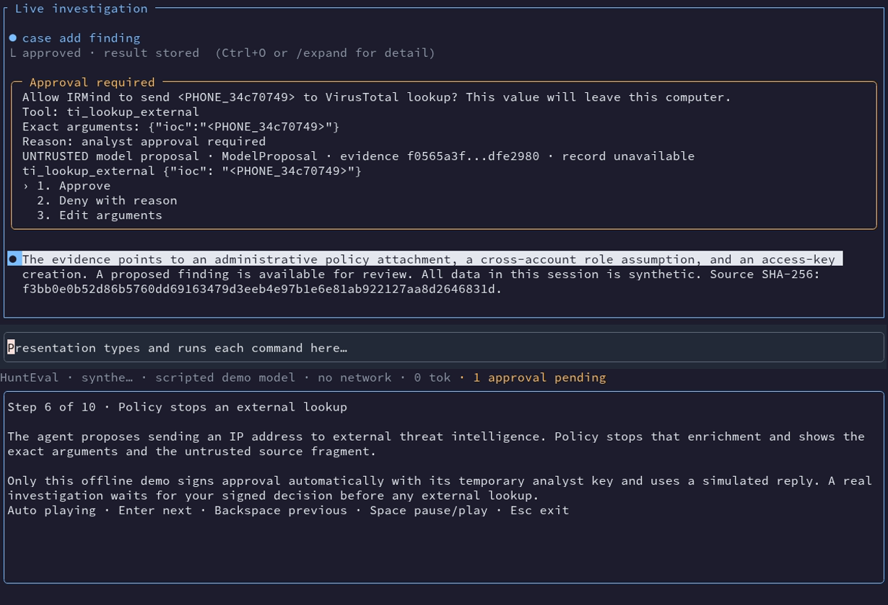
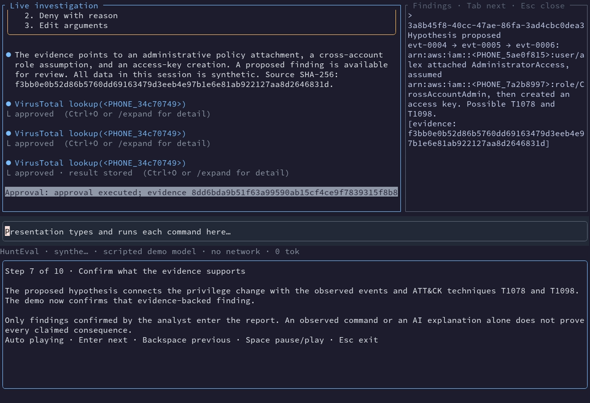
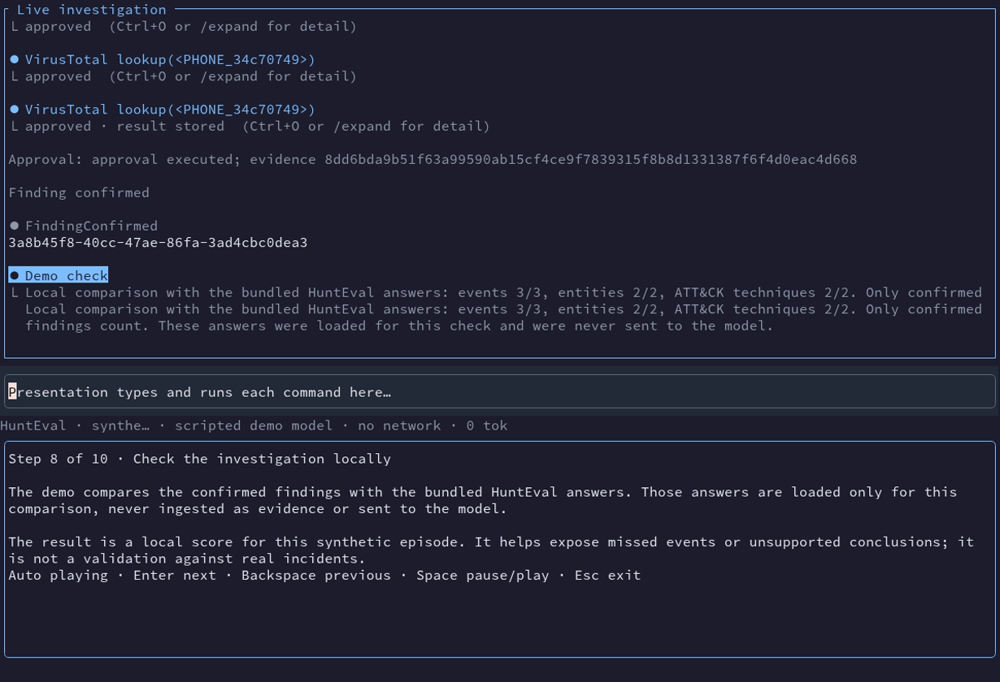
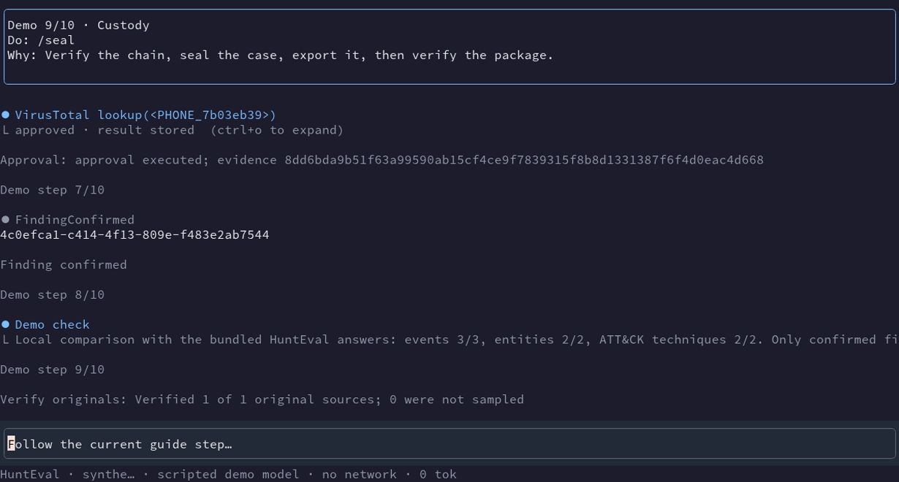
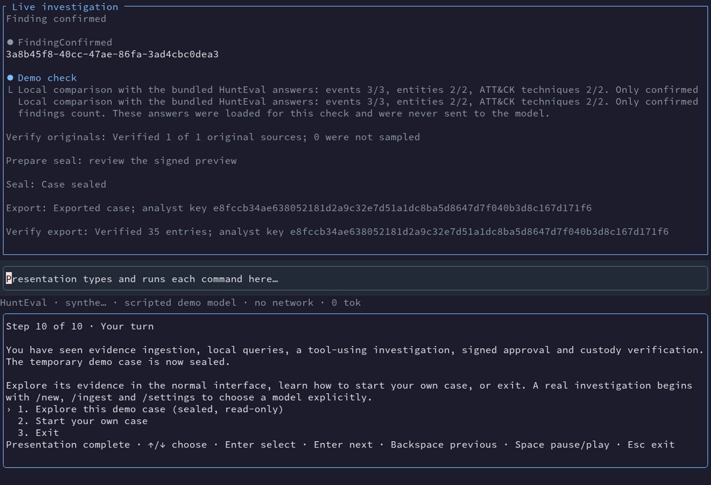
