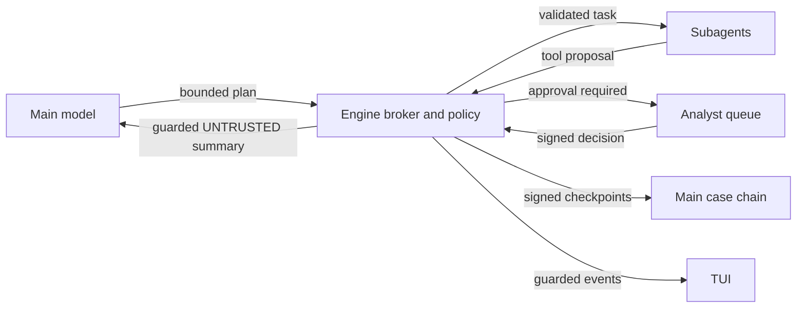

# Bounded subagents and engine events

Approved architecture for v0.5, based on the v0.4.2 case budgets, common-event pipeline
and signed skill receipts. This document proposes contracts and formats; it does
not implement delegation or approve a new port, dependency or credential.
[Español](../es/subagents-design.md) · [Roadmap](roadmap.md) ·
[Skill receipts](skills-case-format-contract.md) ·
[Case budgets](../../crates/app/src/case_budget.rs)

## Model and boundaries

The main agent may propose a bounded plan containing independent tasks. Each task
has an objective, an immutable source restriction, a type, an optional active
skill, a budget slice and a deadline within the parent turn. A trusted engine
broker validates the complete plan before starting work. At most 16 tasks belong
to one plan; the proposed concurrency default is two, with a fixed maximum of
eight, reduced by the shared CPU/memory budget. These are proposed new bounds,
not changes to the existing organization ceilings.

Subagents are model tasks inside the trusted engine, not downloaded native
plugins or newly isolated OS processes. Existing EVTX process containment is
unchanged. A subagent has a separate conversation and cannot create another
subagent.
`delegate_task` is absent from its catalog and is rejected by the broker even if
the model manufactures it. No autonomous tree, background watch or unattended
execution is introduced. The main agent receives bounded results, decides what
to investigate next, and proposes findings; only the analyst confirms findings.
A simple greeting still requires no tools or delegation.

A plan fixes the producing IRMind version, case and turn IDs, parent audit
checkpoint, source inventory, mapping/skill/type identities, effective scope and
budget allocation. Task IDs derive from the case, turn and plan ordinal, never
from model text or completion order. Changing a task means cancelling it and
recording a replacement, not editing signed input in place.

The main agent and children use the analyst-selected model/session endpoint.
Delegation does not select another provider, acquire credentials, install a
method or change configuration. No remote provider is enabled by this feature.

## Types and methodology

| Built-in type | Purpose | Default tools and methods |
| --- | --- | --- |
| Triage | Inventory sources, identify gaps and propose a bounded next step. | Local evidence/graph reads, `skill_read`, unconfirmed findings; relevant core triage methods. |
| Cloud | Investigate a declared AWS, Azure or GCP source subset. | Local reads and configured Read connectors when separately authorized; corresponding cloud skills. |
| Endpoint | Correlate logons, execution and persistence on declared hosts. | Local reads and verified originals; Windows/Linux methods. |
| Network | Correlate flows, DNS, HTTP, TLS and unconfirmed source alerts. | Local graph reads and originals; network method. |
| Kubernetes | Correlate audit and Falco records within declared clusters/namespaces. | Local reads and originals; the two Kubernetes methods. No live API or container execution. |
| Threat intelligence | Check a bounded set of observed indicators. | Local reads and configured Read-only intelligence connectors, each behind existing policy/approval checks. |

The actual tool set is an intersection: compiled catalog, organization policy,
case scope, task restrictions, type declaration and any loaded skill's declared
tools. A declaration never authorizes a call. Types do not add a fallback to a
wider tool set when an intersection is empty. Native tool names and typed filters
come from the existing [catalog](../../crates/app/src/tool_catalog.rs).

Version 0.5 has only the six bundled types above. Their fixed declarations bind
an immutable release inventory hash; the case freezes the exact bundled type
snapshot before use. No community type compiler, package store, installation
operation or type-admission export section is implemented in v0.5. Names and
descriptions share a 16 KiB model-visible catalog cap with skill metadata and
remain within the existing context ceiling.

Type text and skills, including signed content, pass through ContentGuard and
remain UNTRUSTED user/tool messages with the child's nonce. Only fixed trusted
IRMind instructions enter the system role. The model sees names/descriptions
first and loads methodology progressively. The existing four-distinct-skills,
eight-resource-reads and 64 KiB per-turn methodology limits are shared by the
whole parent turn, not multiplied by the number of children.

## Context, source restrictions and policy

Children receive only the screened objective, declared source references,
confirmed findings relevant to the task and admitted methodology. They do not
inherit the entire parent history, credentials, private expected answers,
unrelated cases or another child's conversation. A distinct engine-generated
nonce and child conversation ID are bound to each task descriptor; the child
cannot choose or reuse a peer nonce. Each child's tool-call IDs and tool results
stay linked through the provider-native protocol. Provider reasoning is never replayed or presented as evidence. Existing context byte limits,
compaction, output bounds and nonce isolation remain applicable; compaction is
charged to the shared budget and produces a signed child record.

The broker owns a validated `TaskSourceRestriction`: explicit existing evidence
hashes plus narrower typed remote-source constraints where requested. Local
queries apply that restriction before sampling, aggregation, expansion and
result limits, including `graph_summary`, search and original reads. The current
`GraphQueryFilter` alone does not express an allowed source-hash set. Therefore
this design proposes an internal trusted restriction and reviewed additive
filtered query contracts; it does not claim the current filter already isolates
child source subsets. Unfiltered fallback is forbidden. New evidence from an
authorized remote call is admitted to that task only after the broker verifies
its main-chain source receipt and records the admission in a checkpoint. It does
not expose a sibling's concurrent acquisitions or permit model-selected hashes.

Every dispatch rechecks the current case and organization ceilings. A narrower
policy takes effect immediately; a wider policy does not silently widen a frozen
task. An inventory or mapping change that invalidates the frozen view pauses
the task for an explicit replacement plan; unrelated new sources stay excluded.
Invalid hosts, clusters, namespaces, dates, accounts, indicators or source
references produce Deny, never an unfiltered query or an approval that overrides
the organization. Existing result/sample/hop/expansion limits, Parquet hash checks
and the ten-second graph query budget remain unchanged. Co-observation is not
causality, and missing semantic mappings produce coverage warnings.

Children cannot approve, confirm a finding, raise `/budget`, change scope,
authorize a local evidence root, install a type/skill, select a provider or change
Chronicle `scope_mode`. A source using instance mode retains its signed effective
scope and permanent TUI warning. Subagent type/skill text cannot request that
configuration change through another tool.

Calls needing approval enter the existing analyst queue with task ID/type,
objective, tool, exact arguments, taint provenance and the original source
excerpt. The queue never accepts a child-supplied approval flag or signature.
Approval binds the committed proposal, task restriction, current policy and exact
arguments; editing arguments creates a replacement proposal that is revalidated.
A pending approval releases the execution slot so unrelated bounded tasks can
continue. Later approval still requires current limits and source authorization.

Existing repeated-call detection remains per parent turn. A cached result is
reusable only for identical canonical arguments, effective policy, source
restriction and query/configuration snapshot. Never reuse a broader sibling's
result in a narrower task. Record the reuse, retain provenance and normal
accounting rules, and wrap the guarded body with the receiving child's nonce;
no second remote execution is needed for an equivalent authorized call.

## Visible plan and signed threshold confirmation

Before any child starts, the TUI presents the entire frozen plan: objectives,
types, source subsets and reserved tokens/calls/rounds/cloud bytes, alongside
remaining case allowances. The analyst can cancel pending or running work.
The analyst preference **Confirm all subagent plans** defaults to disabled. With
it disabled, a displayed plan at or below 25% starts automatically; with it
enabled, every plan waits for explicit Start. A plan above the threshold always
waits for Start and signed confirmation, regardless of the preference. No child
starts before its plan is displayed. Preference changes use the existing signed
global configuration operation; no model tool can change it. Display/start events
carry no approval capability, and automatic start never substitutes for required
Analyst consent.

Compute remaining tokens/calls under the case transaction as the effective case
allocation intersected with the current organization ceiling, minus recorded
consumption and all outstanding reservations. Apply the test to the aggregate
plan, including its coordination/summary allowance, not to each child:
`4 * plan_tokens > remaining_tokens || 4 * plan_calls > remaining_calls`.
Use checked wide-integer arithmetic. Exactly 25% does not trigger the signature
rule; exceeding either resource does. Reject an over-allocation before preview.

For a plan above that threshold, require an explicit Analyst-signed
`SubagentPlanApprovalV1` in the main chain before any execution reservation or
provider/tool dispatch. It binds the plan commitment, budget checkpoint,
remaining values and proposed amounts. Recalculate under the same lock immediately
before admission; changed plan/budget inputs require a fresh displayed decision.
Cancellation releases only a preview hold and starts no child. A model tool,
subagent, restored event, generic tool approval or caller-supplied boolean cannot
create this consent. Splitting one proposal into children does not evade the test.

## Shared budgets and scheduling

The current [case budget](../../crates/app/src/case_budget.rs) accounts for tokens,
tool calls and reserved cloud bytes; cost is an estimate when pricing/usage exist.
Parallel work must use one durable reservation broker, not independent counters
that are reconciled only after branches merge. The main agent, all children,
skill reads, compaction, summaries and retried calls share the same case
allocation and organization ceilings. Persist reservations under the case
transaction/lock so another IRMind process cannot spend the same allowance. An
analyst cannot reduce an allocation below recorded plus outstanding reserved
consumption; a newly stricter organization ceiling stops new dispatch and cancels
work that is no longer allowed without erasing incurred usage.

Before starting a plan, reserve a bounded total for the turn and carve disjoint
child allowances from it. Suggested child defaults are eight model rounds,
50,000 tokens and 20 calls, further reduced by the parent allocation. The existing
organization round limit (default 25, fixed maximum 100) covers all model requests
in the parent turn, including child rounds and summaries; concurrency does not
multiply it. Child limits can only narrow it. Reserve input plus maximum output
before each provider request. A provider profile must support a defensible
upper bound; otherwise refuse a hard-capped parallel run rather than treating
unknown usage as free. Charge reported usage exactly; if a failed or
cancelled request has uncertain usage, retain a conservative reservation and
label the uncertainty rather than refunding unobserved consumption.

Cloud-byte reservations include failed/partial downloads as today. Local queries,
original readers, query workers and EVTX session witnesses remain shared services;
children cannot create fresh pools to bypass a memory, retained-worker or transfer
limit. Read-only queries may run concurrently within those shared budgets.
Findings, evidence publication and signed append use short canonical commit slots,
not a case lock held across model/network requests.

Version 0.5 enforces tokens, calls, rounds and cloud bytes only. Cost is an
estimate when provider usage and configured prices support it, otherwise
"unavailable". There is no monetary reservation, cost-cap setting or monetary
organization ceiling in this release; unknown cost is never displayed as zero.

At 80% show parent and child consumption. On exhaustion or cancellation, retain
completed work and a partial status. Use a final no-tool summary only if its
reservation fits; otherwise use a local deterministic summary of completed calls,
confirmed findings, pending approvals and remaining tasks. One failing child does
not erase successful siblings. Retrying is explicit, consumes the same case budget
and gets a new task identity linked to its predecessor.

## Custody and deterministic event branches

All private keys stay in IRMind's signer service. Children receive a task-scoped
append capability, not the Agent key. The broker signs child entries as Actor
Agent using the existing trusted binding. Analyst approvals remain Analyst-signed
entries in the main chain; source manifests, mapping receipts and artifact commits
also remain canonical main-chain operations. A child result is methodology or a
claim, never a substitute for source evidence.

A branch has its own sequence, previous-entry hash and Agent signature. Proposed
records and references are:

| Record | Signer and contents |
| --- | --- |
| `SubagentTypeSnapshotV1` | Agent, main chain before the plan; exact one of six bundled declarations, release inventory, interpreter and tool/skill restrictions; no community admission. |
| `SubagentPlanV1` | Agent, main chain; parent checkpoint, turn ID, ordered task descriptors, source restrictions, policy/budget snapshot and reservations. |
| `SubagentPlanApprovalV1` | Analyst, main chain; exact plan and budget checkpoint, remaining/reserved amounts and explicit threshold consent before dispatch. |
| `SubagentReservationV1` | Agent, main chain; unique operation/task, bounded resource reservation or settlement, state and prior authenticated cause. Reserve before dispatch; settle against an already committed branch prefix. |
| `SubagentBranchEntryV1` | Agent, child branch; case/turn/task, local sequence, previous hash, typed kind, bounded payload and recorded timestamp. |
| `SubagentCheckpointV1` | Agent, main chain; task, contiguous sequence range, previous checkpoint, count, ordered entry commitment, task-local evidence admissions and terminal/nonterminal status. |
| `SubagentResultV1` | Agent, main chain after the final checkpoint; final guarded summary, evidence/record references, coverage gaps, pending approvals, usage and partial/error/cancelled status, bound to the final checkpoint. |

Kinds distinguish model requests/guarded replies, tool proposals/results,
compaction, skill receipts, budget decisions and terminal outcomes. Existing
skill snapshots/load receipts retain their exact admission and range checks;
branch-qualified use references are an explicit new contract, not an unreviewed
change to today's `SkillLoadV1` bytes. Reservation records bind model/tool/cloud operations to the signed plan. Refund
only a proven unused reservation, never incurred or uncertain usage. Global
accounting counts usage once by its unique operation ID, whether it is reserved, in a checkpoint or in the final
result. Duplicate or mismatched accounting references invalidate verification.

A tool proposal's branch prefix is checkpointed before its approval becomes
available. The main-chain Analyst decision references that committed prefix.
The later branch result references the already-existing decision and any main
source receipt. This is an acyclic dependency graph: a checkpoint never includes
a result whose approval depends on that same checkpoint. All finding proposals
are similarly committed before analyst confirmation or report inclusion.

A terminal branch entry contains its summary/status and reservation references,
not a hash of its own future checkpoint. Commit that entry, then settle its
already-authenticated usage in the main chain, and append `SubagentResultV1`
there referencing the final checkpoint and reconciled accounting. The main result
must match the terminal summary commitment. No branch entry depends on that later
main result; this also avoids a circular final-result commitment.

For reproducibility, the scheduler assigns canonical tickets by plan ordinal,
model round and tool-call ordinal. It freezes each bounded wave, reserves and
publishes effects in that order, and checkpoints branch chunks ordered by task
ordinal and sequence rather than wall-clock arrival. Independent provider calls
and pure queries can overlap. A waiting approval ends that child's wave; siblings
continue and the recorded next wave makes the choice auditable. There are no
cross-child reads of uncommitted mutable state.

Deterministic merging means the same recorded branch contents have one canonical
merge, independently of completion order. It does not mean real providers return
the same text or that real timestamps can be rewritten to make two runs equal.
The signed plan records actual waves and tickets; tests use scripted responses
and a fixed clock to compare bytes for 1, 2, 4 and N execution workers.

### Encoding and storage bounds

Propose closed versioned event labels and domain-separated SHA-256 commitments
(`irmind-subagent-type-v1`, `irmind-subagent-plan-v1`,
`irmind-subagent-plan-approval-v1`,
`irmind-subagent-reservation-v1`, `irmind-subagent-branch-entry-v1`,
`irmind-subagent-checkpoint-v1`,
`irmind-subagent-result-v1`). A commitment hashes its domain plus NUL and exact
canonical JSON. Use fixed struct field order, explicit nulls, bounded integer
codes, lowercase hashes, canonical existing timestamps and explicitly ordered
lists/maps. Reject duplicate/unknown fields, noncanonical encodings and trailing
bytes. Signed payload labels use the current label/hex canonical convention;
the branch signature challenge has its own domain and binds case, turn, task,
sequence, previous hash and payload commitment. Specify exact fields, bytes and
golden vectors in a separate format contract before writing implementation.

The existing 1 MiB serialized-frame limit stays. Proposed additional caps are
256 KiB per branch payload, 64 entries per checkpoint chunk (also capped by the
frame limit), 4,096 entries/16 MiB per task, 256 tasks/256 MiB per case and 16 KiB
per returned summary. Refuse new work before crossing a bound; retain an explicit
partial terminal record with reserved space. These finite caps need review with
the format vectors. Never concatenate all branch data in memory to verify it.

Use private case-local files, hash-derived paths, 0700 directories/0600 files on
Unix and existing user-only Windows ACLs. Preflight disk space; stage, sync and
publish branch chunks before atomically appending their main-chain commitments
and accounting receipts. No result is treated as durable or approvable before
that append succeeds. Orphan staging files are diagnostic cleanup; referenced
files are never silently removed. An interrupted session retains its authenticated
prefix and does not restart providers/tools on opening a case. Resume/cancel is an
explicit analyst action after current policy and budget validation.

## Export V8, sealing and independent verification

Propose export V8 (`IRMIND-EXPORT-V8\0`, header version 8), keeping the exporter
method `export_case`. Keep Parquet V3, source/mapping formats and seal inventory
V2 bytes unchanged: the main audit hash commits plans/checkpoints/results, while
new typed case validation verifies every referenced branch. This is a proposal,
not a claim that the V7 verifier already supports branches.

Retain current V7 sections and append bounded, counted sections for branch chunks after the skill-admission section, before end-of-file.
Sort chunks by task identity then chunk sequence;
include exactly the referenced material, with no duplicate, missing, unrelated or
trailing frames. Commit full branch prefixes, including failed/cancelled tasks,
not only successful summaries. No unrelated global configuration or secret is
exported. Counts use checked u64 values and the case caps above.

Before sealing/exporting, recompute branch signatures, sequence/hash chains,
checkpoint commitments, plan restrictions, bundled-type/skill references, required plan consent, proposal
approval links, evidence citations and accounting consistency. A missing or
altered committed branch is a verification failure, not an unavailable-model
warning. Verify source/Parquet commitments as today. Offline verification executes
no model, downloaded type or skill code and performs no network requests.

Distinguish authenticated recorded execution from complete original-source
reconstruction and from the truth of a model claim. Guarded-text hashes authenticate
recorded bytes; replaying a pinned guard is a separate check where available.
Preserve the producing executable or re-ingest originals across incompatible
pre-1.0 versions. No implicit migration or legacy reader is proposed.

## Engine stream and TUI

Today the engine exposes [ModelProgress](../../crates/app/src/ports/model.rs)
and the [case runtime](../../crates/tui/src/case/runtime.rs) combines separate
progress/model/seal channels. Replace that presentation coupling with a bounded,
typed engine event subscription and a read-only TUI projection. The engine owns
turns, tasks, approvals, accounting and cancellation. The TUI sends explicit
analyst intents; an event payload is never approval authority.

Versioned events cover message deltas, model rounds, tool proposals/status/results,
queued/decided approvals, task state, coverage, budget and durable checkpoints.
They carry case/turn/task IDs and a monotonic stream cursor. Screen/escape every
externally derived field before crossing the presentation boundary; never emit
keys, raw provider reasoning or unguarded excerpts. Coalesce deltas and shed only
reconstructible transient progress under backpressure. Never drop approval,
terminal, budget or durability events; use bounded backpressure and cancellation.
A reconnect rebuilds authoritative state from committed records and marks an
unfinished streaming preview as transient, rather than repeating a tool call.

`/subagents` uses the common command registry and shows type, objective, source
subset, state, round, tokens/calls/cloud bytes, estimated cost or unavailable,
pending approval and partial status. A selected task can be cancelled; `/pause`
cancels the turn and its children. Existing reserved keys and `/help` remain
consistent. Approval cards identify their child and keep exact arguments and
taint excerpts. Empty/unmapped source coverage stays visible. No letter shortcuts
or new background networking are added.

This prepares the v0.7 engine API, but introduces no TCP listener, socket service,
external client credentials or remote approval mechanism. API transport and client
authentication require their own later design. Keys remain inside IRMind.

Catalog acquisition remains the separate [installation proposal](https://github.com/ns2switch/irmind/pull/271).
This design uses already admitted local method packages and grants no catalog
network or installation capability to a model. Future catalog admission changes
must be reconciled in the concrete receipt/export contract rather than assumed
compatible with today's skill bytes.

## Deferred after v0.5

The following design is retained for later review, not part of the v0.5 ports,
records, configuration or export sections.

### Community types

Community types are data-only TOML packages: name, version, author/license,
interpreter version, methodology text, allowed tool IDs, allowed skill IDs,
relevant common-event categories and proposed budget defaults. Reject unknown
fields, arbitrary expressions, scripts, executable files, imports, duplicate
identities and names colliding with bundled types or commands. Reuse the current
skill package's path/file/text limits rather than inventing a second unbounded
loader; at most 64 active type descriptors are exposed. Their model-visible
metadata shares a 16 KiB catalog byte cap with skill descriptions and still
fits the existing context ceiling; excess activation fails visibly, not by
silently truncating a declaration.

Bundled types bind a release inventory hash. Organization/analyst types use an
explicit global signed installation/update/disable operation with the exact
canonical package hash and immutable admitted versions. Tampering or an
unsupported interpreter disables that type with an actionable warning; it does
not prevent startup. Installation is never a model tool or an automatic download.
The case records the exact snapshot and admission proof used, independently of
later live catalog changes. This needs its own reviewed canonical contract.

### Monetary limits

A requested cost cap requires a typed pricing snapshot and conservative monetary
reservation in addition to tokens. Without suitable pricing, reject the requested
cost-capped run with a clear explanation; do not treat unknown cost as zero.
Provider usage/billing can differ, so display estimates and unknown usage honestly.
The present budget type does not enforce money: the cost reservation format and
organization ceiling are proposed additions requiring review before implementation.

## Proposed contract review

| Proposed capability | Boundary requiring review before implementation |
| --- | --- |
| Bundled type inventory | Six release-fixed declarations and bounded case snapshots; community compiler/store/installation are deferred. |
| `SubagentBranchStore` | Private bounded staging/readback, checkpoint publication and crash recovery; no signing key access. |
| Shared reservation broker | Atomic case/turn/task reservations and accounting receipts, tokens, calls, rounds and cloud bytes only in v0.5; no independent child budget authority. |
| Trusted source-restricted queries | Additive graph/query contracts that enforce the broker's source subset before limits, without trusting a model-supplied allowlist. |
| `EngineEventSubscription` | Bounded typed presentation events, cursors and explicit cancellation intents; no approval capability in event data. |

These are design proposals, not additions to current traits. Keep `SourceDecoder`,
`SourceMapper`, `LlmPort`, the unversioned `export_case` method and signer
capabilities unchanged where possible. Review concrete signatures, task-qualified
approval references and the V8 encoding before implementation.

## Required tests and implementation sequence

1. Approve this design, then the concrete port/format/golden contract. Proposed
   contracts cover bundled snapshots, signed plan confirmation, branch storage, shared reservations,
   trusted source-restricted queries and engine event subscriptions. No new
   production dependency is planned; review any dependency or credential before
   incorporation. Reuse existing model, guard, signer and approval services.
2. Implement one-child execution and branch/checkpoint/export verification before
   parallel scheduling. Add flipped bytes, wrong case/task/Agent key, duplicate or
   reordered/missing entries, wrong bundled inventory, missing/forged threshold consent, circular approval links, altered
   budget counts and 1 MiB boundary tests. Fuzz current canonical/export frames.
3. With the obedient malicious fake model, try child recursion, undeclared tools,
   scope escape, cross-cluster identities, Chronicle instance-mode changes,
   approval/confirmation forgery, budget raises, model-forged plan consent and malicious skill
   instructions. They remain denied; all external content stays out of system.
4. Test exactly 25% and one unit above for tokens and calls, changed budgets after
   preview, cancellation and model attempts to skip consent. Race reservations at
   case/turn/child limits, exhausted budgets, unavailable cost estimates,
   failed/cancelled usage, duplicate receipts and multiple waiting approvals.
   Prove one accounting charge per request and no overspend by concurrent starts.
5. Build a synthetic Windows/AWS/Kubernetes episode. Delegate three independent
   tasks concurrently, progressively load core methods, use typed category/outcome/
   role filters and verified originals, then return guarded cited summaries.
   Analyst-confirm findings from all three; verify, seal, export V8 and independently
   verify with the expected key. Expected answers are evaluator-only after the
   final response and absent from every request, tool, case and export.
6. Compare fixed-clock scripted bytes with 1/2/4/N workers and shuffled completion
   order. Test slow/failed children, approval pauses, disk/signature/publication
   errors, restart, individual/global cancellation and no orphan process/session.
   Add bounded-memory/backpressure checks, TestBackend snapshots and native PTY
   cases on Linux/macOS/Windows, including 80×24 and active instance warnings.
7. Measure release builds against serial execution on the same runner: end-to-end
   latency, provider wait versus local work, tokens, calls, reserved bytes, peak RSS
   and branch/export disk. Parallelism is not assumed to lower cost; keep current
   ingestion/query limits and publish partial/worst-case results honestly.

| Existing issue | Refined scope and disposition |
| --- | --- |
| [#87](https://github.com/ns2switch/irmind/issues/87) | Design/contract review; keep open until the design is accepted, not merely written. |
| [#88](https://github.com/ns2switch/irmind/issues/88) | Bounded engine event stream and read-only TUI projection, cancellation and reconnect; proposed milestone v0.5. |
| [#89](https://github.com/ns2switch/irmind/issues/89) | Types including Kubernetes, source restrictions, reservations and bounded parallel scheduler; v0.5. |
| [#90](https://github.com/ns2switch/irmind/issues/90) | Branches, acyclic approval checkpoints, accounting, deterministic merge and export V8; v0.5. |
| [#91](https://github.com/ns2switch/irmind/issues/91) | Subagent panel, attributed approval cards, partial results and cancellation; v0.5. |

Use `area/subagents` for the scheduler/panel, `area/engine` for the stream/branch
contracts and `security` for scope/accounting/verification tests. Design-dependent
implementation is not yet a good first issue. The separate
[Windows collection evaluation](https://github.com/ns2switch/irmind/pull/284)
exercises the current single-agent skill and does not implement this design.
