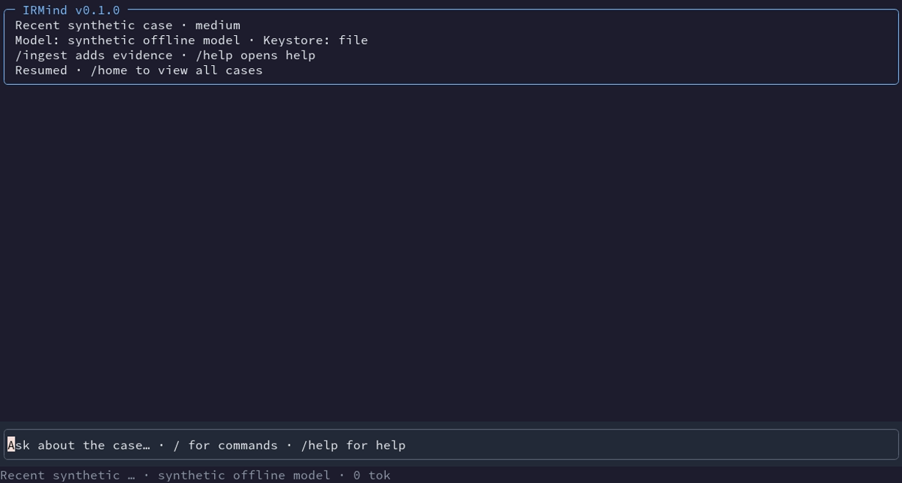
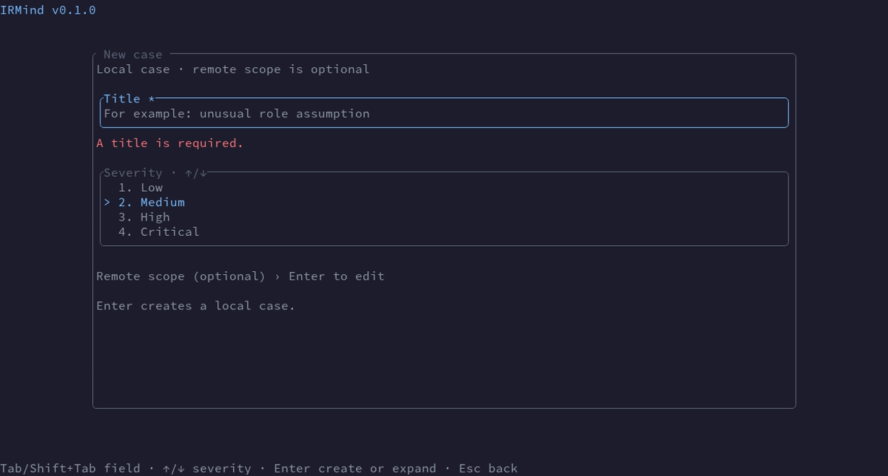
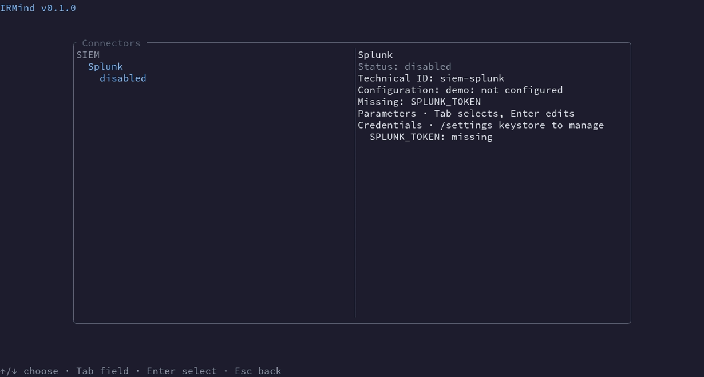
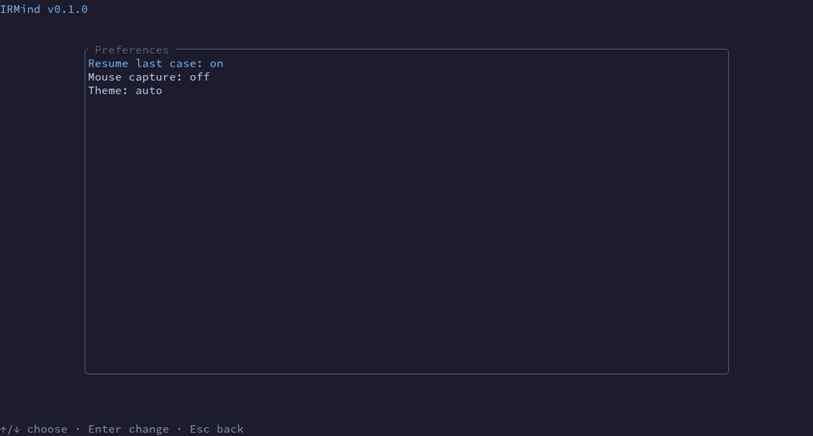
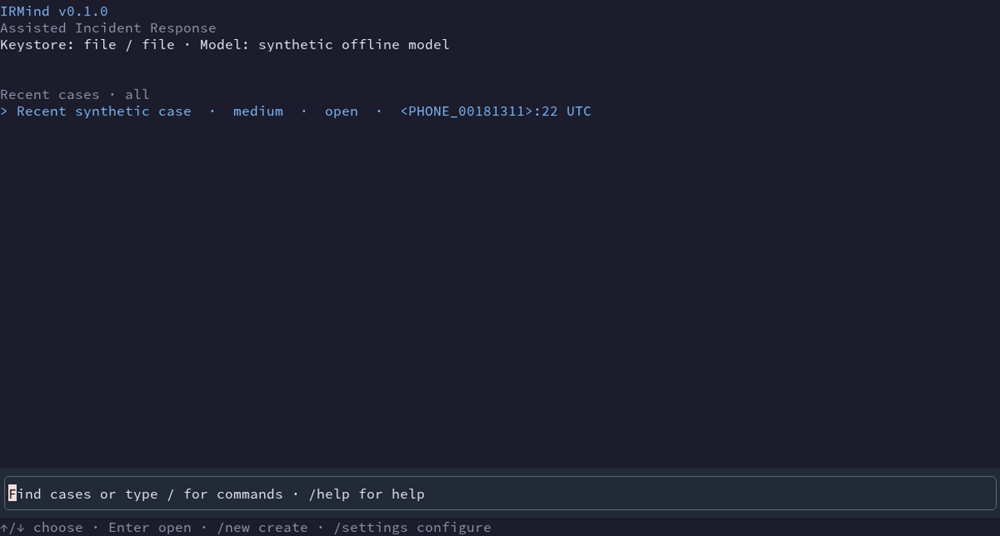
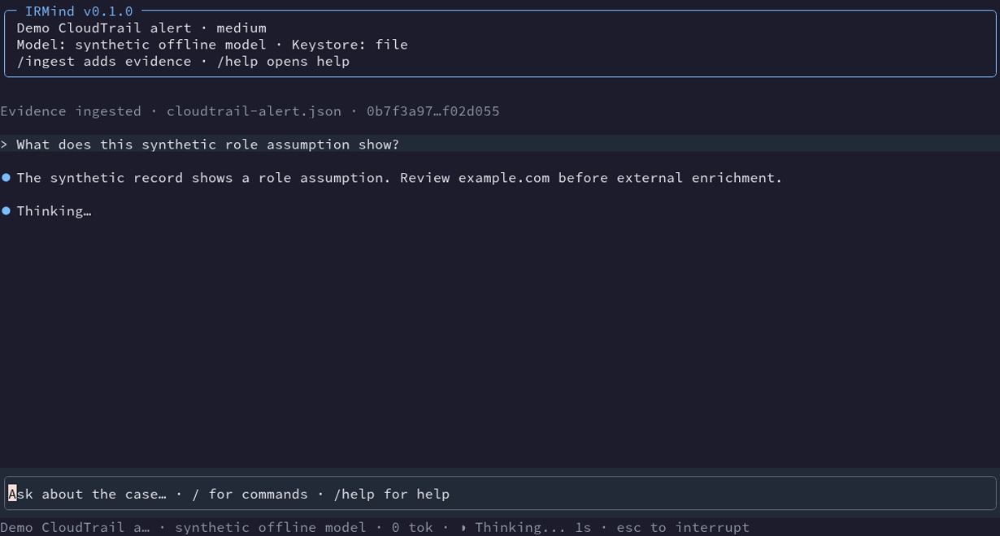
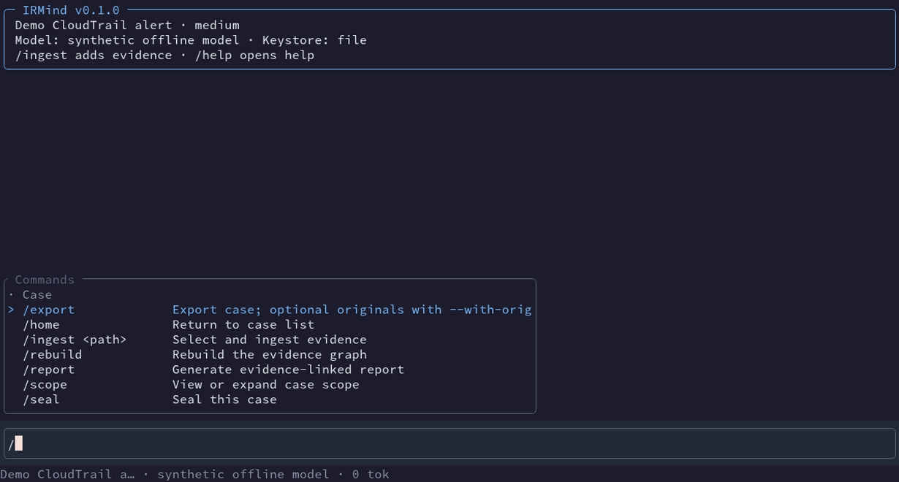
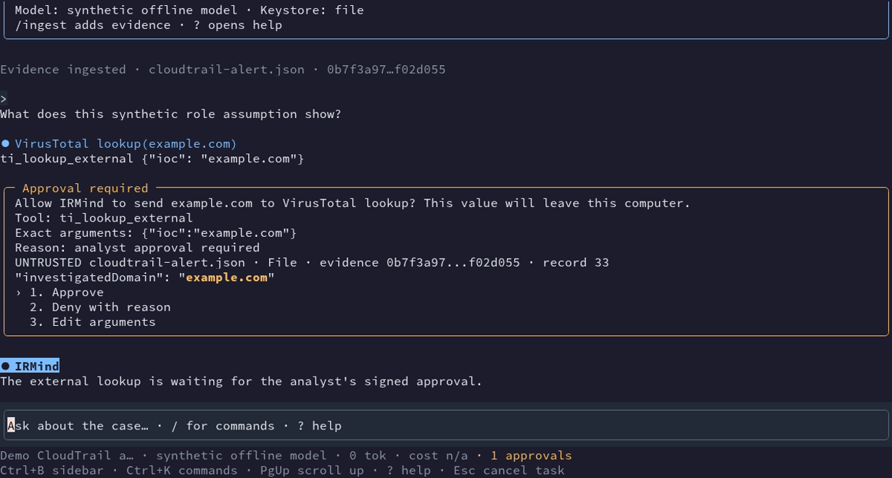

Traducción de docs/getting-started.md en el commit a333bb3ffc4a9d695d1facf42461c43ce3d2dc7f; si hay diferencias, prevalece la versión en inglés.

# Primeros pasos

Esta guía es para analistas que evalúan IRMind con datos sintéticos. Explica cómo instalarlo y abrir un primer caso local. Lee el [modelo de seguridad](security-model.md) antes de conectar un servicio real.

> IRMind está en desarrollo. No lo uses para incidentes reales ni datos sensibles.

## Instalación

La opción recomendada para uso interno es compilar desde el código. Instala Rust 1.95.0 y un terminal compatible. Puedes elegir el archivo cifrado sin disponer de un llavero del sistema. Después ejecuta:

```sh
rustup toolchain install 1.95.0
cargo build --release --locked -p irmind
./target/release/irmind
```

En Windows, ejecuta `.\target\release\irmind.exe` desde Windows Terminal. Cuando haya un artefacto de CI disponible, también puedes descargarlo y comprobar `SHA256SUMS` antes de usarlo. Consulta [plataformas](platforms.md) para los pasos de cada sistema. Los binarios aún no están firmados.

## Primer arranque

Al ejecutar `irmind` sin subcomando se abre la TUI. El asistente explica por qué se firman los casos y permite elegir `os` o `file` por separado para la firma y los secretos. Usa las flechas y Enter para elegir cada backend; las opciones no disponibles aparecen atenuadas con el motivo y no se pueden seleccionar. Ambos se compilan por defecto; IRMind nunca cambia de backend en silencio. Preselecciona `file` si no hay llavero del sistema. Pide dos veces la passphrase en campos enmascarados dentro de la TUI, comprueba su longitud y funciona por SSH sin sesión gráfica. Esc retrocede y Ctrl+C pide confirmación para salir. En el primer uso se crea la clave del analista y se muestra su huella pública. Guárdala fuera del equipo por un canal de confianza.

Si falla el desbloqueo, el asistente muestra el motivo y permite reintentar o elegir otro backend. Una passphrase errónea no cierra la TUI. Los errores inesperados apuntan a `diagnostics.log` en el directorio de datos. La selección queda en `keystore.toml`. Escribe `/settings keystore` para ver los backends y la huella, gestionar credenciales, cambiar la passphrase o migrar. La entrada de secretos permanece enmascarada dentro de la TUI. Tras sustituir una credencial, los conectores activos conservan el valor anterior; escribe `/restart` para reiniciar la sesión.

La compilación normal incluye todos los módulos de producto actuales y ambos llaveros, pero no habilita ningún LLM ni conector. El paso opcional «Modelo de IA» del primer arranque, o `/settings model` después, ofrece Ollama, LM Studio y vLLM locales, además de los proveedores remotos documentados en [configuración](configuration.md). Ollama comprueba `http://127.0.0.1:11434`; si no responde, arráncalo con `ollama serve` y reintenta. Para un proveedor remoto, indica la URL y la clave enmascarada. Se pide permiso antes de consultar su lista de modelos o probarlo con texto sintético; habilitarlo para datos del caso requiere otra confirmación firmada. Escribe `/settings connectors` para ver los módulos, usa flechas para seleccionarlos y Tab y Enter para editar sus campos públicos. `/settings keystore` gestiona las credenciales. La sesión se recarga tras aprobar un cambio.


Después del primer uso, IRMind suele reabrir el último caso abierto tras verificar su cadena de custodia. Si está sellado, se ha eliminado o no supera la verificación, aparece el inicio; un fallo de verificación muestra además un aviso. Usa `/home` para ver todos los casos o `/settings preferences` para desactivar la reanudación. En el inicio, escribe texto normal en la entrada inferior para filtrar títulos, o usa `/cases all|open|sealed|inconsistent` para filtrar por estado. ↑/↓ selecciona un caso y Enter lo abre.



`/new` empieza con título obligatorio y una lista de severidades (media preseleccionada). Enter crea un caso local. Tab lleva al paso opcional de alcance remoto: fuentes, cuentas, proyectos, hosts, prefijos de objetos y límites UTC tienen campos visibles y validación en línea. No se puede crear un alcance por encima del techo de la política. `/settings connectors` agrupa los nombres legibles por tipo; el detalle muestra el ID técnico, los parámetros públicos editables, las credenciales que faltan y la feature de un módulo no compilado. `/settings model`, `/settings connectors` y `/settings keystore` abren diálogos centrados; Esc vuelve a Ajustes.








La demo sin conexión muestra dos módulos ilustrativos; la compilación normal incluye todos los módulos de producto actuales.



Si `config.toml` requiere recuperación, la TUI ofrece restaurarlo o revisar los cambios campo a campo antes de abrir casos. Los flags y variables de entorno que cambian los destinos se muestran y requieren confirmación; rechazarlos mantiene los ajustes guardados.

## Primer caso sintético

1. Escribe `/settings model` para elegir y probar un proveedor en la TUI, o posponlo para trabajar solo con evidencia local. Consulta [configuración](configuration.md) para conocer los proveedores.
2. Escribe `/new`, introduce un título como «Alerta de CloudTrail de prueba» y elige una severidad. Enter crea un caso local firmado; el alcance remoto es opcional.
3. Escribe `/ingest` y selecciona [el archivo sintético de CloudTrail](../../examples/cloudtrail-alert.json). IRMind calcula su hash en la ubicación original y crea un índice Parquet. Solo copia el original si usas expresamente `/ingest --copy-original <ruta>`.
4. Pregunta «¿Qué sugiere el evento AssumeRole sintético?» y pulsa Enter. La respuesta aparece de forma incremental. Usa `/timeline` o `/graph` para examinar los eventos y `/search <palabras>` para buscar registros.
5. Revisa las llamadas propuestas en la conversación. Una consulta externa exige una aprobación firmada con opciones numeradas; usa las flechas y Enter. Escribe `/` para ver sugerencias o pulsa Ctrl+K para abrir la paleta. Si se alcanza un límite, revisa el resumen y usa `/continue`.
6. Ejecuta `/verify <directorio-origen>` para comprobar los bytes originales, revisa `/report` y usa `/seal` y `/export` después de comprobar el hash del caso y la huella de la clave de firma que se muestran.

Puedes verificar el paquete en otro equipo con `irmind verify-export <PACKAGE> --expected-key <FINGERPRINT>`. Consulta la [referencia de la CLI](../development/cli.md) para automatización.

## Navegar por el caso

La conversación ocupa el espacio principal. La tarjeta inicial muestra el caso, el modelo y el llavero. Las propuestas, aprobaciones, resultados y hallazgos aparecen en orden. Los resultados largos empiezan plegados con un resumen. `/sidebar` muestra u oculta los paneles. Tab mueve el foco desde la entrada a la conversación y por los paneles visibles; Esc vuelve. `Ctrl+O` despliega un resultado seleccionado. En una aprobación, usa ↑/↓ y Enter, o escribe 1/2/3 y después Enter para aprobar, denegar con motivo o editar argumentos.

Las consultas del grafo y las búsquedas locales también aparecen como tarjetas de resultado. Selecciona la tarjeta y pulsa Enter o `Ctrl+O` para desplegarla, y desplázate por la conversación.

En casos Parquet grandes, añade `--from=<UTC> --to=<UTC>`, `--account=<ID>` o `--project=<ID>`, y `--region=<NOMBRE>` a `/search`, `/entity`, `/neighbors`, `/entity-timeline` o `/path`. Por ejemplo, `/search AssumeRole --from=2026-10-28T12:00:00Z --to=2026-10-28T13:00:00Z --account=123456789012 --region=eu-west-1` lee solo las particiones y horas coincidentes. Los dos límites UTC deben ir juntos y el filtro debe quedar dentro del alcance del caso. La tarjeta de vecinos indica cuándo su muestra de 4.096 registros es parcial.

Con un SIEM configurado, `/siem-alert` obtiene una alerta dentro del alcance por su ID. El resultado aparece como una tarjeta protegida y plegable en la conversación. `/help` muestra el orden de los argumentos.



PgUp/PgDn desplazan la vista enfocada. El texto nuevo del modelo sigue el final solo si ya estás allí. ↑/↓ recuperan entradas anteriores cuando el campo está vacío. `/help` lista todos los comandos y las teclas reservadas. Los caracteres imprimibles siempre se escriben en el campo; ninguna letra ejecuta un atajo. La rueda del ratón funciona por defecto. Para seleccionar texto con el terminal, pon `mouse_capture = false` en la [configuración](configuration.md) y acepta el cambio desde la TUI.



Una consulta externa espera la aprobación firmada del analista. La tarjeta muestra los argumentos exactos y el fragmento de evidencia sintética del que procede el valor no confiable.



## Siguientes pasos

Consulta [configuración](configuration.md) para el alcance, la política, los backends y los nombres de credenciales. Consulta [módulos](modules.md) para los permisos y límites de los conectores y [plataformas](platforms.md) para el uso por SSH. La TUI es el flujo principal; los subcomandos sirven para automatizar tareas.
