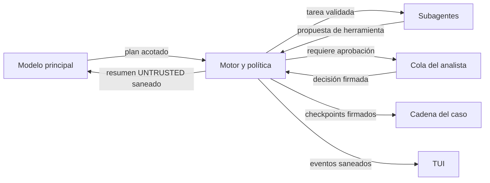

Traducción de docs/development/subagents-design.md en el commit db8cff9c095e616be5bbb56072849b131258900d; si hay diferencias, prevalece la versión en inglés.

# Subagentes acotados y eventos del motor

Arquitectura aprobada para v0.5 basada en los presupuestos de caso, el esquema común y los
recibos de skills de v0.4.2. Define contratos y formatos propuestos; no implementa
delegación ni aprueba puertos, dependencias o credenciales.
[English](../development/subagents-design.md) · [Roadmap](roadmap.md) ·
[Recibos de skills](../development/skills-case-format-contract.md) ·
[Presupuestos actuales](../../crates/app/src/case_budget.rs)

## Modelo y límites

El agente principal propone un plan de tareas independientes. Cada tarea fija
objetivo, restricción de fuentes, tipo, skill activa opcional, presupuesto y plazo
no superior al del turno principal. Un mediador confiable del motor valida el
plan completo antes de ejecutarlo. Se proponen como máximo 16 tareas por plan y
concurrencia inicial de dos, con techo fijo de ocho y reducción adicional según
el presupuesto compartido de CPU y memoria. Son límites nuevos propuestos, no
cambios a los techos actuales de la organización.

Los subagentes son tareas de modelo dentro del motor confiable, no plugins
nativos descargados ni procesos nuevos con aislamiento de sistema operativo.
El aislamiento EVTX actual no cambia. Cada subagente tiene una conversación
propia y no puede crear otros. Su catálogo
no contiene `delegate_task`; el mediador también rechaza cualquier intento de
inventarlo. No se introducen árboles autónomos, watches ni ejecución desatendida.
El principal recibe resultados acotados y propone hallazgos; solo el analista los
confirma. Un saludo sigue sin necesitar herramientas ni delegación.

El plan fija versión de IRMind, caso, turno, punto de la cadena principal,
inventario de fuentes, identidades de mapeos/skills/tipos, alcance y presupuesto.
Los identificadores de tarea se derivan del caso, turno y ordinal del plan, nunca
del texto del modelo ni del orden de finalización. Cambiar una tarea exige
cancelarla y registrar otra enlazada, no editar una entrada firmada.

Principal e hijos usan el modelo y endpoint que seleccionó el analista. Delegar
no cambia proveedor, obtiene credenciales, instala métodos ni altera ajustes.
Esta función no habilita proveedores remotos.

## Tipos y metodología

| Tipo incluido | Propósito | Herramientas y métodos iniciales |
| --- | --- | --- |
| Triaje | Inventariar fuentes, señalar carencias y proponer el siguiente paso acotado. | Lecturas locales, `skill_read`, hallazgos sin confirmar y métodos de triaje. |
| Nube | Investigar fuentes AWS, Azure o GCP declaradas. | Lecturas locales y conectores Read configurados, sujetos a autorización independiente; skills de nube. |
| Endpoint | Correlacionar accesos, ejecución y persistencia en hosts declarados. | Lecturas locales y originales verificados; métodos Windows/Linux. |
| Red | Correlacionar conexiones, DNS, HTTP, TLS y alertas de origen sin confirmar. | Grafo y originales locales; método de red. |
| Kubernetes | Correlacionar auditoría y Falco en clústeres/namespaces declarados. | Lecturas locales y originales; las dos skills de Kubernetes. Sin API en vivo ni ejecución en contenedores. |
| Inteligencia | Comprobar indicadores observados y acotados. | Lecturas locales y conectores de inteligencia de solo lectura, con política y aprobaciones actuales. |

Las herramientas efectivas son la intersección del catálogo compilado, política,
alcance del caso, restricciones de tarea, declaración del tipo y herramientas de
la skill cargada. Declarar una herramienta no la autoriza. Una intersección vacía
no activa un catálogo más amplio. Los identificadores y filtros salen del
[registro común actual](../../crates/app/src/tool_catalog.rs).

En v0.5 solo están los seis tipos incluidos de la tabla. Sus declaraciones
fijas vinculan el hash del inventario de la release; el caso congela la
instantánea exacta antes de usarlas. No hay compilador, almacén, instalación
ni sección de admisiones para tipos comunitarios en v0.5. Nombres y descripciones
comparten 16 KiB con metadatos de skills y respetan el techo de contexto.

El texto de tipos y skills pasa por ContentGuard y permanece como datos UNTRUSTED
en mensajes user/tool con el nonce del hijo, incluso si está firmado. Solo las
instrucciones fijas y confiables de IRMind entran en system. La carga es progresiva:
primero nombres y descripciones. Los límites actuales de cuatro skills distintas,
ocho lecturas de recursos y 64 KiB de metodología son compartidos por todo el
turno principal; no se multiplican por el número de subagentes.

## Contexto, fuentes y política

Cada hijo recibe objetivo saneado, referencias declaradas, hallazgos confirmados
relevantes y metodología admitida. No recibe todo el historial del principal,
credenciales, respuestas esperadas privadas, otros casos ni conversaciones de sus
hermanos. Un nonce y un identificador de conversación generados por el motor
quedan vinculados a la tarea; el hijo no los elige ni reutiliza los de otro.
Las llamadas y resultados conservan los identificadores del protocolo del
proveedor. El razonamiento del proveedor no se reenvía ni se trata como evidencia.
Se mantienen límites de contexto, compactación, salida y aislamiento. Compactar
consume el presupuesto compartido y deja un registro firmado de la rama.

El mediador controla una `TaskSourceRestriction` validada: hashes de evidencia ya
existente y restricciones remotas tipadas más estrechas cuando proceda. Todas las
consultas locales la aplican antes del muestreo, agregación, expansión y límites,
incluidos `graph_summary`, búsqueda y originales. El `GraphQueryFilter` actual
no representa una lista de hashes permitidos: se propone una restricción interna
confiable y contratos filtrados aditivos que habrá que revisar. Nunca se omite
el filtro como alternativa. La evidencia nueva de una consulta remota autorizada
solo se admite para esa tarea después de verificar su recibo de origen en la
cadena principal y registrarlo en un checkpoint. No expone adquisiciones de
otros hijos ni acepta hashes elegidos por el modelo.

Cada ejecución vuelve a comprobar el techo vigente del caso y la organización.
Un techo reducido se aplica enseguida; ampliarlo no amplía silenciosamente una
tarea congelada. Si cambia el inventario o mapeo e invalida la vista congelada,
se pausa la tarea y hace falta un plan de sustitución explícito; las fuentes
nuevas ajenas siguen excluidas. Hosts, clústeres, namespaces, fechas, cuentas, indicadores y
referencias inválidos producen Deny, nunca una consulta sin filtro ni una
aprobación que supere el techo. No cambian muestreo, resultados, saltos, expansión,
hashes Parquet ni el presupuesto de diez segundos de consulta. La co-observación
no prueba causalidad; la falta de mapeos produce avisos de cobertura.

Los hijos no aprueban, confirman hallazgos, amplían `/budget`, cambian alcance,
autorizan raíces locales, instalan tipos/skills ni cambian proveedor o
`scope_mode` de Chronicle. Una fuente en modo instancia conserva su alcance
firmado y el aviso permanente. Ningún texto de metodología convierte esos
cambios de configuración en herramientas disponibles.

Una aprobación pendiente llega a la cola del analista con tarea/tipo, objetivo,
herramienta, argumentos exactos, procedencia tainted y extracto de origen. No se
aceptan firmas ni indicadores de aprobación que mande el hijo. La decisión queda
vinculada a la propuesta ya comprometida, su restricción y argumentos; editar
argumentos crea otra propuesta y repite la validación. Esperar aprobación libera
el puesto de ejecución para otras tareas. Al reanudar siguen aplicándose los
límites, plazos y autorizaciones vigentes.

La detección de llamadas repetidas sigue aplicándose por turno principal. Solo
se reutiliza un resultado con argumentos canónicos, política, restricción de
fuentes e instantáneas de consulta/configuración idénticos. No se pasa el resultado
de un hermano más amplio a una tarea más estrecha. Se registra la reutilización,
se conservan procedencia y contabilidad y se envuelve el cuerpo saneado con el
nonce del receptor, sin ejecutar otra consulta remota equivalente.

## Plan visible y confirmación firmada por umbral

Antes de arrancar hijos, la TUI muestra el plan completo: objetivos, tipos,
fuentes y tokens/llamadas/rondas/bytes reservados, junto al presupuesto restante.
El analista puede inspeccionarlo, iniciarlo o cancelarlo. No hay temporizador
ni forma de que el modelo omita esa vista. Iniciar un plan pequeño desde la TUI
no convierte los eventos del motor en autoridad de aprobación.

Bajo la transacción del caso se calcula lo restante: intersección entre asignación
y techo organizativo vigente, menos consumo y reservas pendientes. Se prueba
el total del plan, incluida coordinación/resumen, no cada hijo:
`4 * plan_tokens > remaining_tokens || 4 * plan_calls > remaining_calls`.
Aritmética ancha comprobada. Exactamente 25% no exige firma por esta regla;
superar cualquiera de los dos recursos sí. Se rechaza exceder la asignación.

Por encima del umbral se exige `SubagentPlanApprovalV1` firmado por Analyst en la
cadena principal antes de reservar ejecución o llamar a proveedores/herramientas.
Vincula compromiso del plan, checkpoint de presupuesto, cantidades restantes y
propuestas. Se recalcula bajo el mismo bloqueo al admitirlo: si cambia plan o
presupuesto hay nueva vista y decisión. Cancelar libera solo la retención de
previsualización y no inicia hijos. Ni el modelo, ni un hijo, ni un evento
restaurado, ni una aprobación de herramienta, ni un booleano del llamante pueden
crear el consentimiento. Dividir el plan en hijos no elude la prueba.

## Presupuestos compartidos y planificación

El presupuesto actual cuenta tokens, llamadas y bytes de nube reservados; el coste
es estimado si hay precios y uso. Se necesita un mediador duradero de reservas
común, no contadores independientes que se sumen solo al fusionar las ramas.
Principal, hijos, skills, compactación, resúmenes y reintentos consumen la misma
asignación del caso y los mismos techos de organización. Las reservas persisten
bajo transacción/bloqueo del caso para que otro proceso no gaste la misma cuota.
No se reduce la asignación por debajo del consumo registrado más las reservas
pendientes. Un techo organizativo nuevo más estricto detiene nuevas ejecuciones
y cancela lo que ya no esté permitido, sin borrar consumo incurrido.

Antes de iniciar el plan se reserva un total para el turno y se reparte en cuotas
disjuntas. Se sugieren ocho rondas, 50.000 tokens y 20 llamadas por hijo, reducidos
por la asignación principal. El límite organizativo de rondas (25 por defecto,
100 de máximo fijo) cubre todas las peticiones del turno, incluidos hijos y
resúmenes; la concurrencia no lo multiplica. Se reserva entrada y salida máxima
antes de cada petición. El perfil del proveedor debe permitir una cota superior
defendible; sin ella se rechaza la ejecución paralela con tope estricto. Se cobra
el uso conocido; si un error o cancelación deja uso incierto, se conserva una
reserva conservadora y se indica la incertidumbre, sin devolver consumo no observado.

Las reservas de transferencia incluyen descargas fallidas/parciales. Consultas,
lectores de originales, trabajadores y testigos EVTX siguen siendo servicios
compartidos; los hijos no crean pools para eludir límites de memoria, trabajadores
retenidos o nube. Las lecturas pueden solaparse dentro de ese presupuesto.
Hallazgos, publicación de evidencia y firmas usan turnos canónicos breves, sin
mantener el bloqueo del caso durante peticiones de modelo o red.

En v0.5 solo se imponen tokens, llamadas, rondas y bytes de nube. El coste es
una estimación cuando existen precios y uso adecuados, o "no disponible".
No hay reservas ni ajustes de límite monetario ni techo organizativo en dinero
en esta versión. Un coste desconocido nunca se muestra como cero.

Al 80% se muestra consumo principal y del hijo. Agotar límites o cancelar conserva
el trabajo y un estado parcial. El resumen final sin herramientas solo se pide si
cabe su reserva; si no, se genera localmente a partir de llamadas completadas,
hallazgos confirmados, aprobaciones y tareas pendientes. Un hijo fallido no borra
los resultados de otros. Reintentar es explícito, consume presupuesto y crea una
nueva identidad vinculada a la tarea anterior.

## Custodia y fusión determinista

Las claves privadas permanecen en el servicio de firma de IRMind. Un hijo recibe
capacidad de append limitada a su tarea, no la clave Agent. El mediador firma sus
entradas como Actor Agent con el vínculo de confianza existente. Las aprobaciones
Analyst, manifiestos, mapeos y artefactos permanecen en la cadena principal. Un
resultado de subagente es metodología o una afirmación, no evidencia sustitutiva.

Cada rama tiene secuencia, hash anterior y firma Agent. Se proponen estos registros:

| Registro | Contenido y firmante |
| --- | --- |
| `SubagentTypeSnapshotV1` | Agent, principal antes del plan; uno de los seis tipos incluidos, inventario de release, intérprete y herramientas/skills; sin admisión comunitaria. |
| `SubagentPlanV1` | Agent, cadena principal; checkpoint padre, turno, tareas ordenadas, restricciones y reservas. |
| `SubagentPlanApprovalV1` | Analyst, principal; plan y checkpoint de presupuesto exactos, cantidades restantes/reservadas y consentimiento explícito antes de ejecutar. |
| `SubagentReservationV1` | Agent, principal; operación/tarea única, reserva o liquidación acotada de recursos, estado y causa autenticada anterior. Reservar antes de ejecutar; liquidar contra un prefijo ya comprometido. |
| `SubagentBranchEntryV1` | Agent, rama; caso/turno/tarea, secuencia local, hash anterior, tipo, contenido acotado e instante registrado. |
| `SubagentCheckpointV1` | Agent, principal; tramo contiguo, checkpoint previo, contador, compromiso ordenado, nuevas admisiones de evidencia y estado terminal o no. |
| `SubagentResultV1` | Agent, principal después del checkpoint final; resumen saneado, citas, carencias, aprobaciones pendientes, consumo y estado, vinculado al checkpoint final. |

Los tipos distinguen peticiones/respuestas, herramientas, compactación, skills,
presupuestos y finalización. Se mantienen las comprobaciones de admisión/rangos
de skills; sus referencias con ámbito de rama requieren un contrato nuevo
explícito, no cambiar sin revisión los bytes actuales de `SkillLoadV1`. Las
reservas vinculan operaciones de modelo/herramientas/nube al plan. Solo se devuelve
una reserva de uso que se sabe no consumido, nunca gasto incurrido o incierto. Cada
operación de uso se contabiliza una sola vez por identidad única; referencias
duplicadas o inconsistentes invalidan la verificación.

El prefijo con una propuesta de herramienta se compromete antes de ofrecer su
aprobación. La decisión Analyst en la cadena principal referencia ese prefijo.
El resultado posterior referencia la decisión existente y sus recibos de fuente.
El grafo es acíclico: un checkpoint no incluye un resultado cuya aprobación
dependa de ese mismo checkpoint. Los hallazgos también se comprometen antes de
confirmarse o entrar en informes.

La entrada terminal de la rama incluye resumen/estado y referencias de reservas,
no el hash de su checkpoint futuro. Se compromete esa entrada, después se liquida
el uso autenticado en la cadena principal y se añade allí `SubagentResultV1`
referenciando checkpoint final y contabilidad conciliada. Su resumen debe coincidir
con el compromiso terminal. Ninguna entrada depende de ese resultado posterior;
así tampoco hay un compromiso circular de finalización.

El planificador asigna turnos canónicos por ordinal de tarea, ronda y llamada.
Congela cada oleada acotada, reserva y publica efectos en ese orden, y compromete
ramas por ordinal/secuencia, no por orden de llegada. Peticiones independientes
y lecturas puras se solapan. Una espera de aprobación termina la oleada de ese
hijo; los demás continúan y la oleada siguiente queda registrada. No hay lecturas
cruzadas de estado mutable sin comprometer.

La misma colección de entradas registradas tiene una única fusión canónica. No
se promete que proveedores reales generen idénticas respuestas ni se reescriben
instantes reales. Los tests usan respuestas scripted y reloj fijo para comparar
bytes con 1, 2, 4 y N trabajadores y distinto orden de finalización.

### Codificación y almacenamiento

Dominios separados: `irmind-subagent-type-v1`, `irmind-subagent-plan-v1`,
`irmind-subagent-plan-approval-v1`,
`irmind-subagent-reservation-v1`, `irmind-subagent-branch-entry-v1`,
`irmind-subagent-checkpoint-v1` y
`irmind-subagent-result-v1`. El compromiso SHA-256 incluye dominio, NUL y JSON
canónico: orden fijo de campos, null explícito, códigos enteros cerrados, hashes
minúsculos, instantes canónicos y listas/mapas ordenados explícitamente. Se
rechazan campos desconocidos/duplicados y bytes sobrantes. Los payloads usan la
convención actual etiqueta/hex; la firma de rama tiene dominio propio y vincula
caso, turno, tarea, secuencia, hash previo y compromiso. Los campos y bytes exactos
y sus golden se fijarán en otro contrato antes de implementar.

Se mantiene 1 MiB por frame serializado. Se proponen 256 KiB por payload, hasta
64 entradas por chunk también sujeto a 1 MiB, 4.096 entradas/16 MiB por tarea,
256 tareas/256 MiB por caso y 16 KiB por resumen. Estas cotas requieren revisión
con los vectores. Se reserva espacio para la finalización parcial y se rechaza
trabajo nuevo antes de excederlas. La verificación será en streaming.

Ficheros privados en el caso, rutas por hash, directorios 0700/ficheros 0600 en
Unix y ACL del usuario en Windows. Comprobar disco antes; preparar, sincronizar
y publicar chunks antes de añadir atómicamente los compromisos y consumo a la
cadena principal. Nada es durable ni aprobable antes de completar ese append.
Los temporales huérfanos se limpian con diagnóstico, sin borrar referencias
comprometidas. Tras un cierre se conserva el prefijo autenticado; abrir el caso
no reejecuta proveedores/herramientas. Reanudar o cancelar requiere una acción
explícita y revalidación de política/presupuesto.

## Export V8, sello y verificación independiente

Se propone export V8 (`IRMIND-EXPORT-V8\0`, cabecera 8), manteniendo el método
`export_case`, Parquet V3, formatos de origen/mapeo y bytes del inventario de sello
V2. El hash principal compromete planes/checkpoints/resultados; la validación
tipada nueva comprueba todas las ramas. El verificador V7 actual no lo implementa.

Tras las secciones actuales de V7 y las pruebas de skills se añaden secciones
acotadas con contador para chunks de rama, ordenados por tarea y secuencia. Se incluye exactamente lo
referenciado, sin duplicados, omisiones, extras ni bytes finales. Se exportan
prefijos fallidos/cancelados, no solo resúmenes exitosos. No se incluye configuración
global ajena ni secretos. Contadores u64 comprobados y cotas del caso.

Antes de sellar/exportar se recalculan firmas, secuencias, hashes, compromisos,
restricciones, inventario de tipos, consentimiento del plan, referencias de skills, vínculos de aprobación, citas y
contabilidad. Una rama comprometida ausente o alterada invalida la verificación;
no es un aviso de modelo no disponible. Fuentes y Parquet se comprueban como ahora.
La verificación offline no ejecuta modelos ni código descargado ni usa red.

Autenticar la ejecución registrada no prueba la verdad de una afirmación del
modelo ni equivale a reconstruir originales. Los hashes autentican el texto
saneado registrado; repetir un guard fijado es otra comprobación cuando sea posible.
La política pre-1.0 sigue exigiendo conservar el ejecutable creador o reingerir;
no se propone migración implícita ni lector histórico.

## Flujo del motor y TUI

Actualmente [ModelProgress](../../crates/app/src/ports/model.rs) y el
[runtime del caso](../../crates/tui/src/case/runtime.rs) combinan canales separados.
Se propone una suscripción acotada de eventos tipados del motor y una proyección
TUI de lectura. El motor controla turnos, tareas, aprobaciones, consumo y
cancelación; la TUI envía intenciones explícitas del analista. Un evento no
constituye autoridad de aprobación.

Eventos versionados: texto/rondas, propuestas/estado/resultados, aprobaciones,
estado de hijos, cobertura, presupuestos y checkpoints duraderos. Incluyen
caso/turno/tarea y cursor monótono. Todo contenido externo se sanea y escapa antes
de cruzar el límite de presentación. Nunca se emiten claves, razonamiento bruto
ni extractos sin guard. Se pueden agrupar deltas y descartar progreso transitorio
reconstruible bajo presión, pero no aprobaciones, finalizaciones, presupuesto ni
durabilidad. Se aplican contrapresión y cancelación acotadas. Al reconectar se
reconstruye estado comprometido; una previsualización incompleta no repite llamadas.

`/subagents`, desde el registro común, muestra tipo, objetivo, fuentes, estado,
ronda, tokens/llamadas/nube, coste estimado o no disponible, aprobaciones y estado
parcial. Permite cancelar una tarea; `/pause` cancela turno e hijos. Se mantienen
teclas reservadas y `/help`; las tarjetas identifican el hijo y conservan argumentos
y extractos tainted. Sin atajos de letras ni red en segundo plano.

Prepara la API de v0.7, sin listeners TCP, servicio de sockets, credenciales de
clientes externos ni aprobación remota. Transporte y autenticación de clientes
requieren otro diseño. Las claves permanecen dentro de IRMind.

La adquisición del catálogo sigue su [propuesta independiente](https://github.com/ns2switch/irmind/pull/271).
Este diseño usa métodos locales ya admitidos y no concede al modelo capacidades
de red o instalación de catálogo. Los cambios futuros de admisión se conciliarán
en el contrato concreto de recibos/export, sin asumir compatibilidad con los
bytes actuales de skills.

## Aplazado para después de v0.5

Se conserva este diseño para revisión futura; no forma parte de puertos,
registros, ajustes ni secciones de exportación de v0.5.

### Tipos comunitarios

Los tipos comunitarios son paquetes TOML de datos: nombre, versión, autor/licencia,
versión del intérprete, metodología, herramientas y skills permitidas, categorías
del esquema común y presupuestos sugeridos. Se rechazan campos desconocidos,
expresiones, scripts, ejecutables, imports, duplicados y nombres que colisionen
con tipos incluidos o comandos. Se reutilizan los límites de ficheros, rutas y
texto del compilador de skills; se exponen como máximo 64 descriptores activos.
Sus metadatos visibles para el modelo comparten 16 KiB con las descripciones de
skills y respetan el techo de contexto. Activar más de lo que cabe falla con un
aviso, sin truncar una declaración silenciosamente.

Los tipos incluidos fijan el hash del inventario de la release. Los tipos de la
organización o del analista se instalan, actualizan o desactivan mediante una
operación global firmada explícita, con compromiso canónico y versiones admitidas
inmutables. La manipulación o un intérprete no soportado desactivan el tipo con un
aviso; no impiden arrancar. El modelo no instala ni descarga tipos. El caso guarda
la instantánea exacta y su prueba de admisión, independientemente de cambios
posteriores del catálogo. Su contrato canónico requiere otra revisión.

### Límites monetarios

Un tope monetario requiere instantánea tipada de precios y reserva conservadora,
además de tokens. Si faltan precios adecuados, se rechaza la ejecución solicitada
con ese tope; coste desconocido no es cero. La facturación puede diferir de la
estimación. El tipo de presupuesto actual no impone dinero: el formato de reservas
y el techo monetario propuestos necesitan revisión antes de implementarse.

## Contratos propuestos que requieren revisión

| Capacidad propuesta | Límite del contrato |
| --- | --- |
| Inventario de tipos incluidos | Seis declaraciones fijadas por la release e instantáneas de caso; compilador, almacén e instalación comunitarios aplazados. |
| `SubagentBranchStore` | Preparación y lectura privada acotada, publicación de checkpoints y recuperación; sin acceso a claves. |
| Mediador de reservas | Reservas atómicas caso/turno/tarea y recibos, solo tokens, llamadas, rondas y bytes en v0.5; ningún hijo controla su propio techo. |
| Consultas restringidas confiables | Contratos aditivos para limitar fuentes antes de muestreo/límites, sin confiar en listas elegidas por el modelo. |
| `EngineEventSubscription` | Eventos tipados acotados, cursores e intenciones explícitas de cancelación; los datos no conceden aprobación. |

Son propuestas, no cambios de traits actuales. Conservar `SourceDecoder`,
`SourceMapper`, `LlmPort`, `export_case` sin versión y las capacidades de firma
cuando sea posible. Revisar firmas concretas, referencias de aprobación por tarea
y bytes V8 antes de implementar.

## Pruebas y secuencia

1. Revisar este diseño y después contratos/golden de instantáneas incluidas, consentimiento del plan,
   ramas, reservas, consultas restringidas y suscripciones. Reutilizar
   modelos, guard, firmante y cola actuales. Sin dependencias nuevas previstas;
   cualquier dependencia o credencial se revisará antes de incorporarse.
2. Implementar primero un hijo y verificación de ramas/checkpoints/export. Tests
   de bytes, caso/tarea/clave erróneos, entradas duplicadas/ausentes/reordenadas,
   inventarios falsos, consentimiento ausente/falsificado, dependencias circulares, consumo y frontera de 1 MiB;
   fuzzing de canónicos y export actuales.
3. Modelo falso obediente: recursión, herramientas no declaradas, salida del
   alcance, identidades entre clústeres, modo instancia, aprobaciones y hallazgos
   falsificados, ampliación de presupuesto, consentimiento de plan falso y skills maliciosas. Todo debe
   quedar denegado y fuera de system.
4. Umbral exacto de 25% y una unidad más en tokens/llamadas, cambios tras la
   vista, cancelación e intentos de omitir consentimiento. Carreras en reservas
   por caso/turno/hijo, agotamiento, coste no disponible, uso
   incierto, duplicados y varias aprobaciones pendientes. Un cargo por operación
   y ningún exceso por arranques concurrentes.
5. Episodio sintético Windows/AWS/Kubernetes con tres tareas paralelas, skills
   progresivas, filtros de categoría/resultado/rol, originales y resúmenes con
   citas. Confirmación Analyst de los tres, verify, sello, export V8 y verificador
   independiente con clave esperada. Respuestas esperadas solo para el evaluador
   después del resultado; ausentes de peticiones, herramientas, caso y export.
6. Comparar bytes con reloj fijo y 1/2/4/N trabajadores. Hijos lentos/fallidos,
   esperas, disco/firma/publicación, reinicio, cancelación individual/global y
   limpieza. Memoria y contrapresión acotadas, snapshots TestBackend y PTY nativo
   Linux/macOS/Windows, incluido 80×24 y aviso de instancia.
7. Medir release frente a ejecución serial en el mismo runner: latencia total,
   espera de proveedor/trabajo local, tokens, llamadas, bytes, RSS y disco de
   ramas/export. Paralelizar no garantiza reducir costes. Mantener todos los
   límites y publicar resultados parciales y peores casos.

| Issue existente | Alcance actualizado propuesto |
| --- | --- |
| [#87](https://github.com/ns2switch/irmind/issues/87) | Mantener abierto hasta aprobar diseño y contrato, no solo redactarlos. |
| [#88](https://github.com/ns2switch/irmind/issues/88) | Flujo acotado del motor, proyección TUI, cancelación y reconexión; v0.5. |
| [#89](https://github.com/ns2switch/irmind/issues/89) | Tipos, incluido Kubernetes, restricciones, reservas y planificación; v0.5. |
| [#90](https://github.com/ns2switch/irmind/issues/90) | Ramas, checkpoints acíclicos, consumo, fusión y export V8; v0.5. |
| [#91](https://github.com/ns2switch/irmind/issues/91) | Panel, aprobaciones atribuidas, resultados parciales y cancelación; v0.5. |

Etiquetas propuestas: `area/subagents` para planificación/panel, `area/engine`
para flujo/ramas y `security` para pruebas de alcance, contabilidad y verificación.
La implementación dependiente del diseño aún no es good first issue. La
[evaluación de Windows](https://github.com/ns2switch/irmind/pull/284) usa el motor
actual de un agente y no implementa este diseño.
