# Home screen visual review

This page is for reviewers comparing the home screen and its dialogs with the previous TUI. All captures use synthetic data, a fake model, an ephemeral signing key, and an offline VHS container. The [capture tape](capture.tape) regenerates the after images.

| Screen | Before | After |
| --- | --- | --- |
| Home | 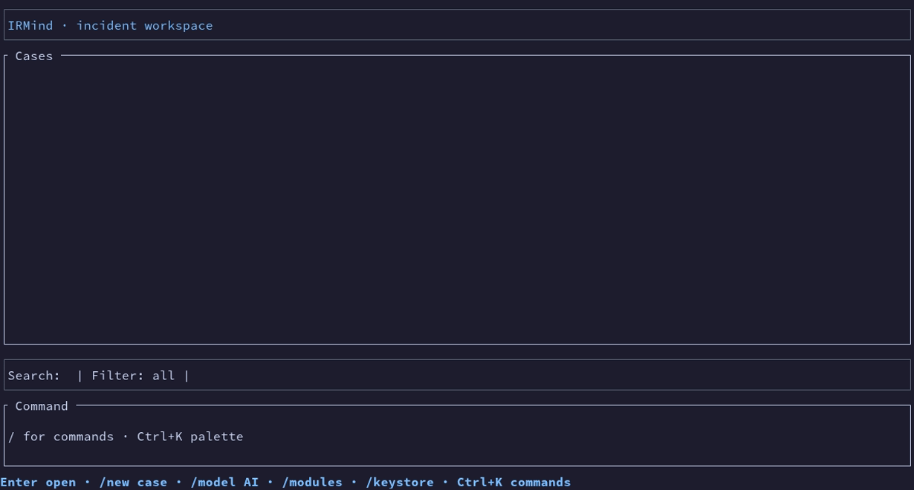 | 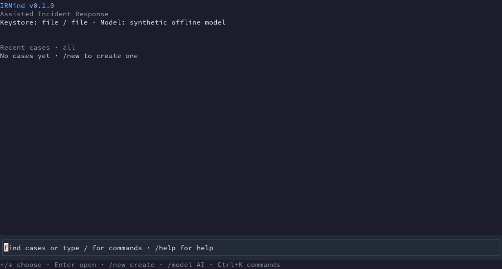 |
| Commands | 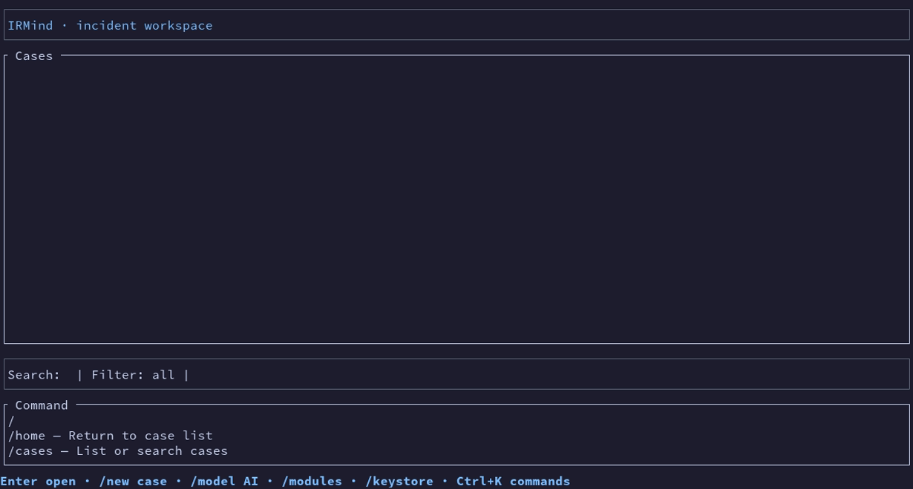 | 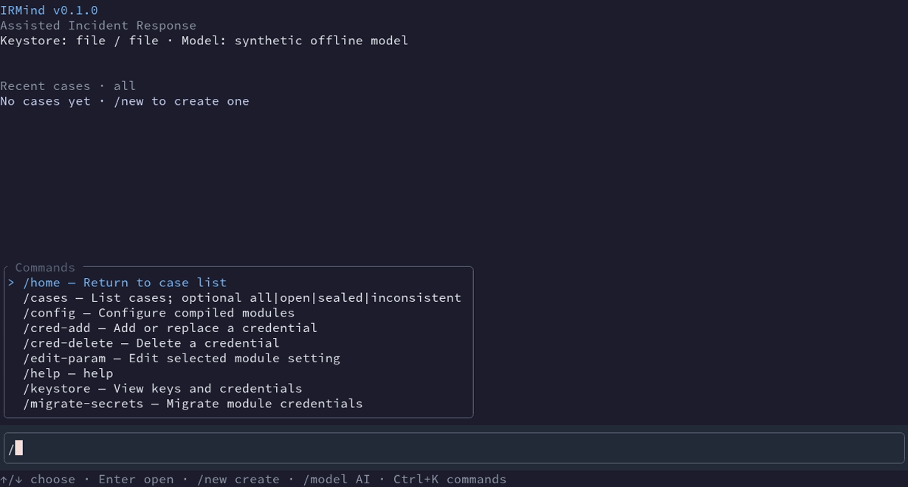 |
| New case | 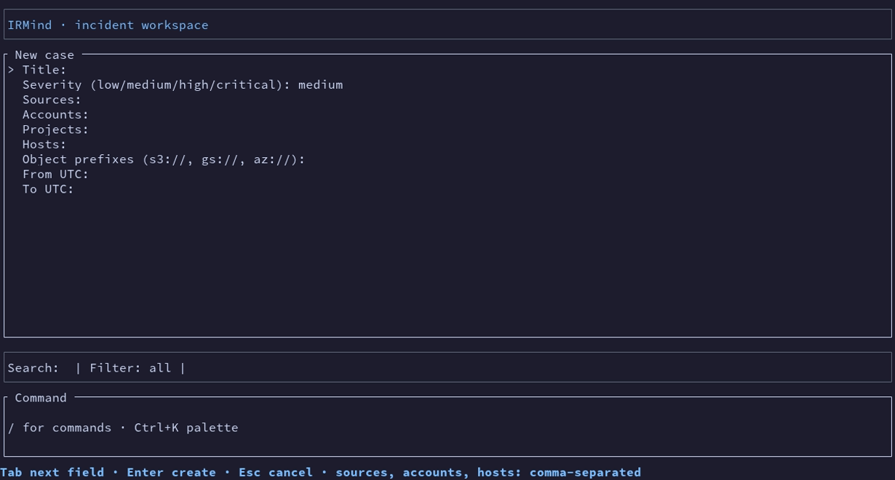 | 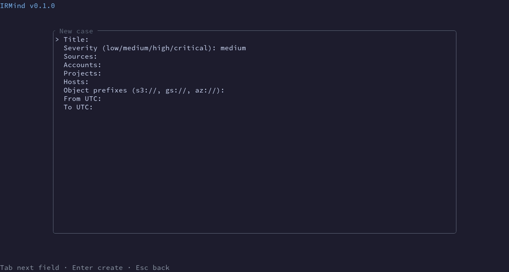 |
| Modules | 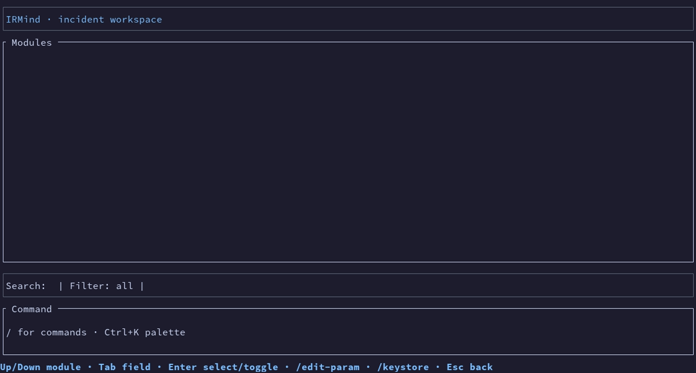 | 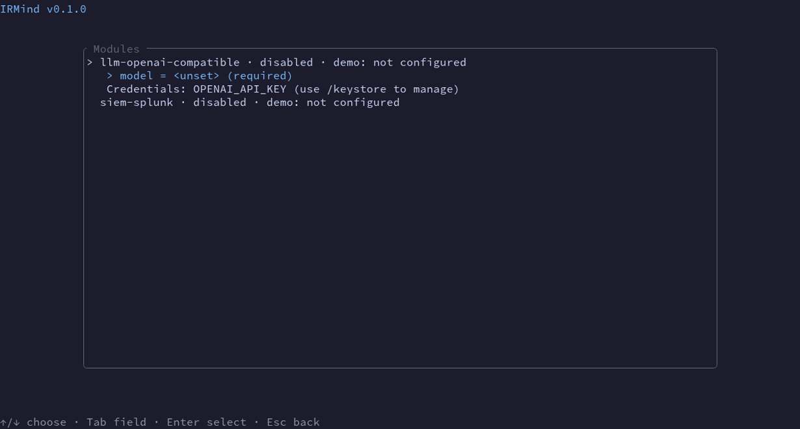 |
| Keystore | 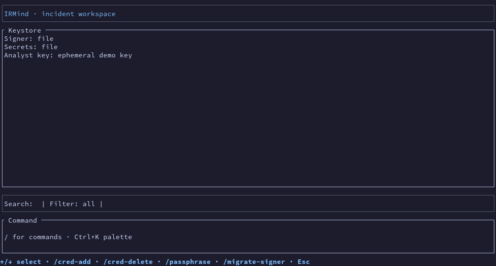 | 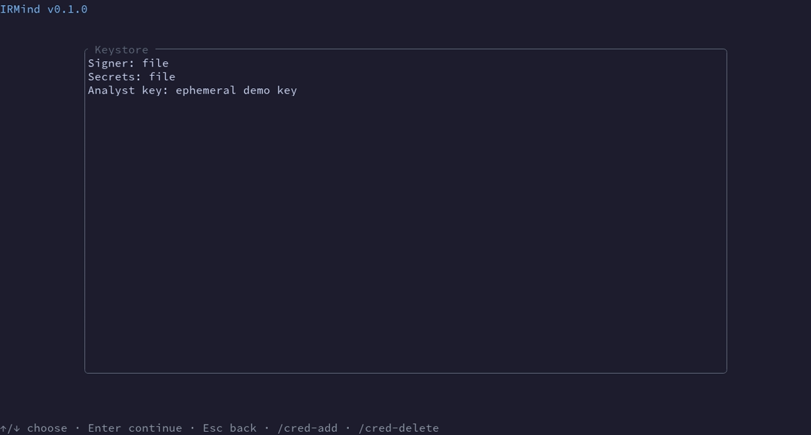 |
| AI model | 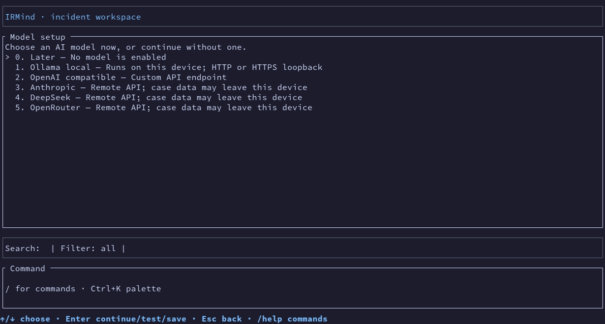 | 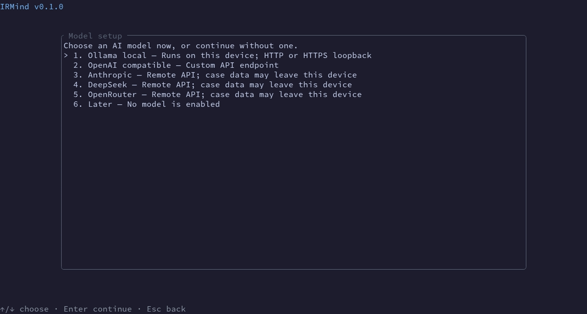 |
