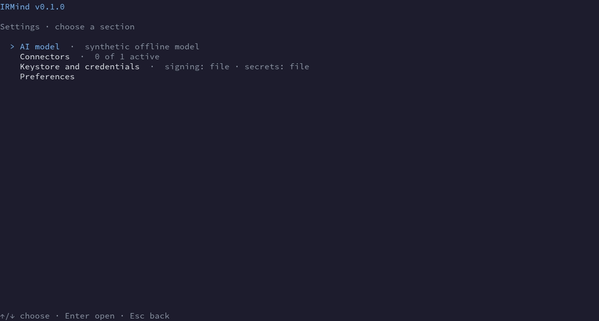
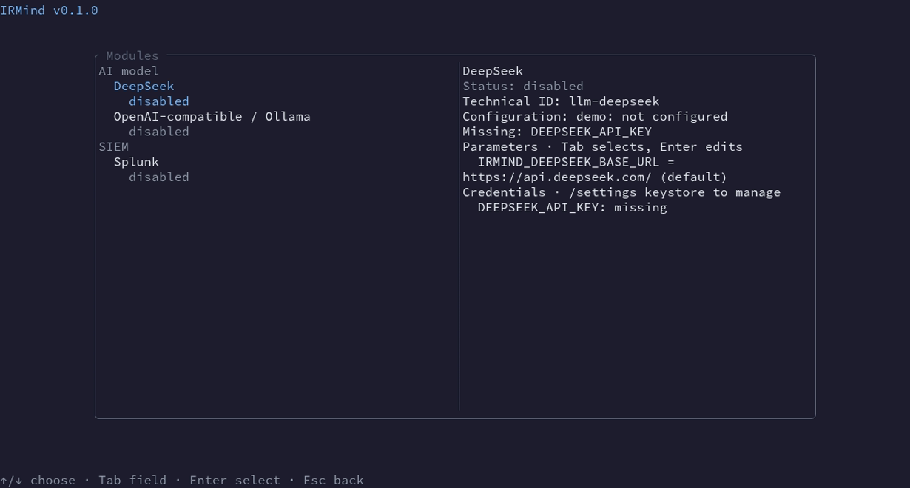
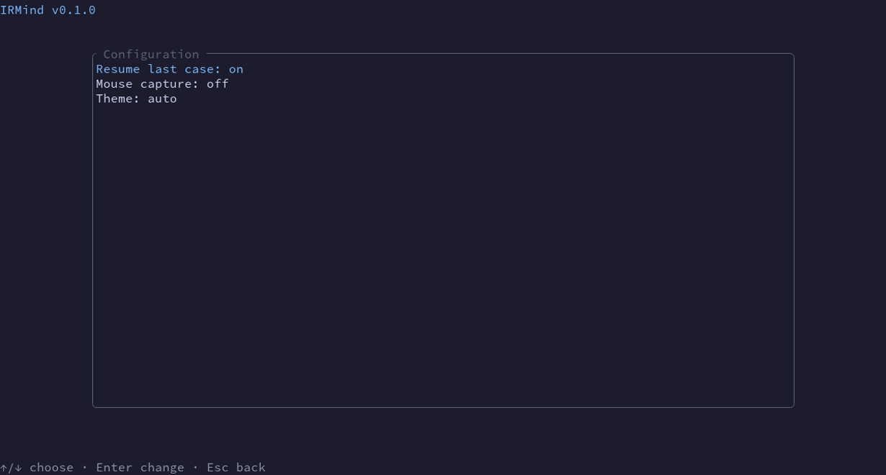

# Settings polish: before and after

These captures use only the offline synthetic demo. They show the interface immediately before and after this change. No real model, connector, credential, or incident data appears.

| Screen | Before | After |
| --- | --- | --- |
| Settings menu |  |  |
| Connectors |  |  |
| Preferences |  |  |
