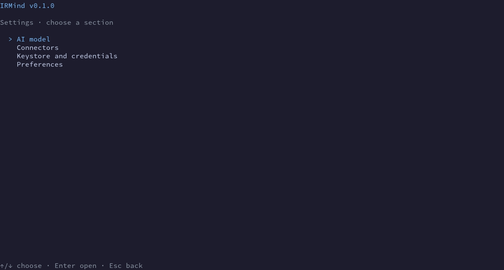
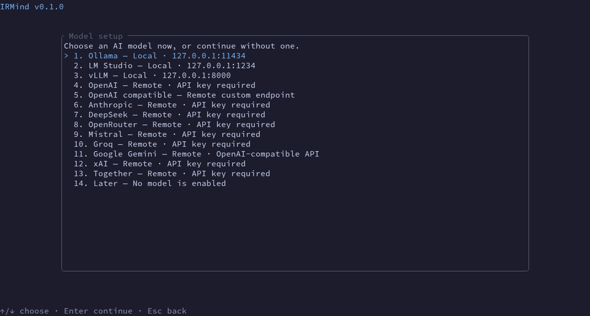
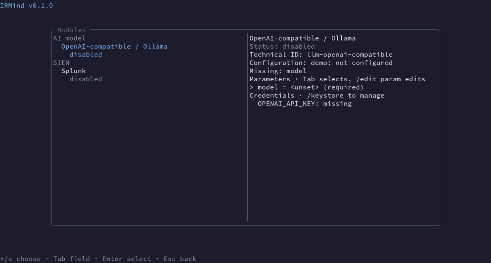
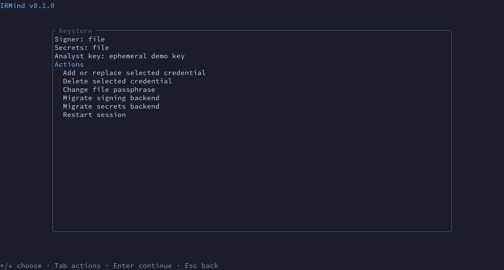
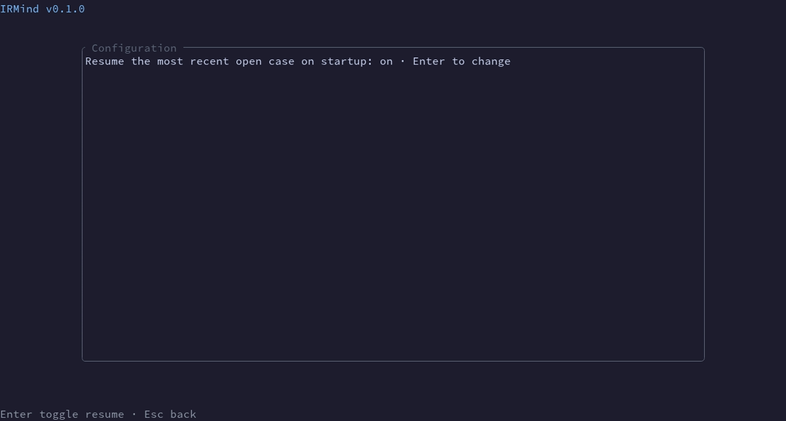

# Settings screen comparison

These captures are for reviewers of the unified settings flow. The before images came from the existing synthetic TUI demo and prior versioned synthetic UI captures. The after images use the offline VHS fixture in `docs/demo/` with an ephemeral file keystore and fake model. No real provider, incident data, or network is involved.

| Screen | Before | After |
| --- | --- | --- |
| Settings navigation | Separate screens; no entry screen |  |
| Model selection |  |  |
| Connectors |  |  |
| Keystore |  |  |
| Preferences |  |  |

The before images show synthetic UI states from earlier commits, not a live machine. The latest after images are also published under `docs/assets/` for the user guide.
