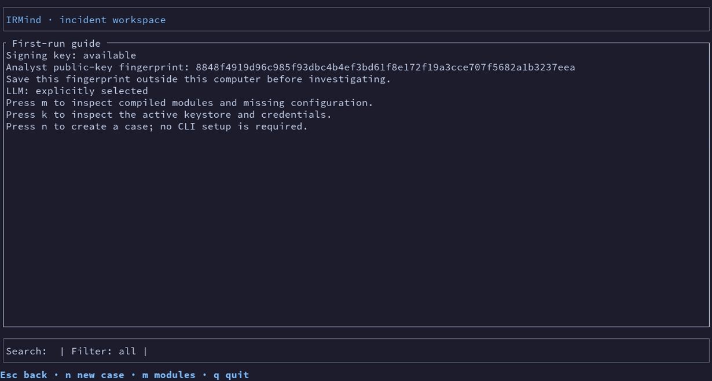
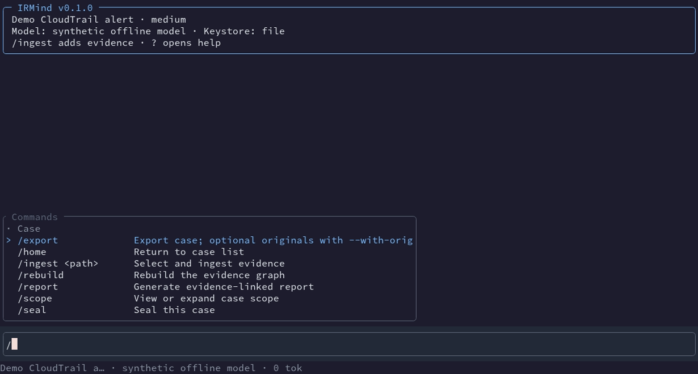
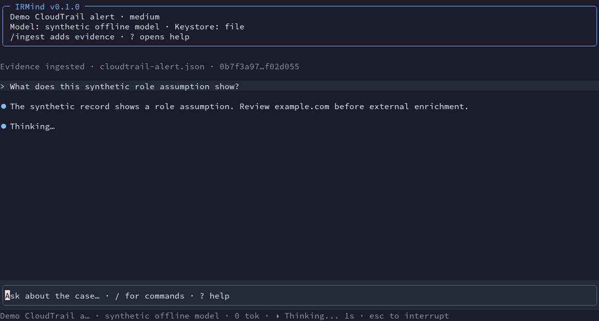
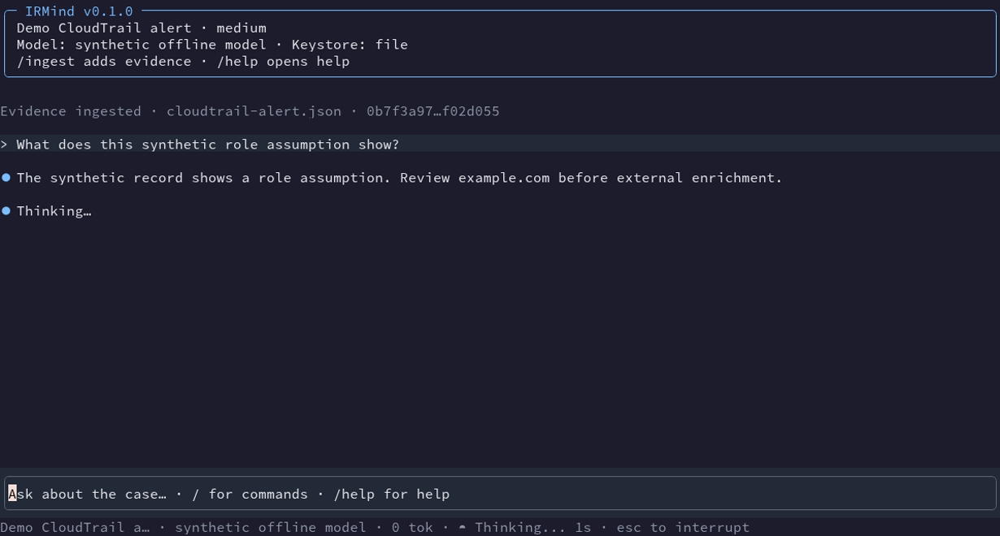
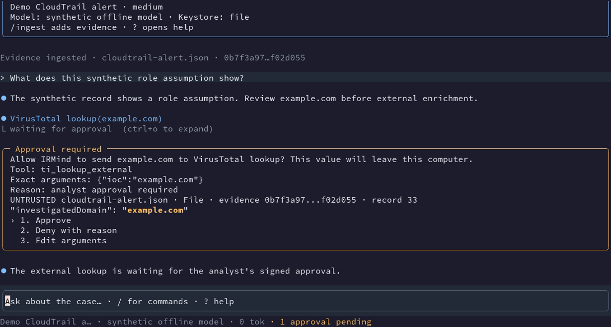
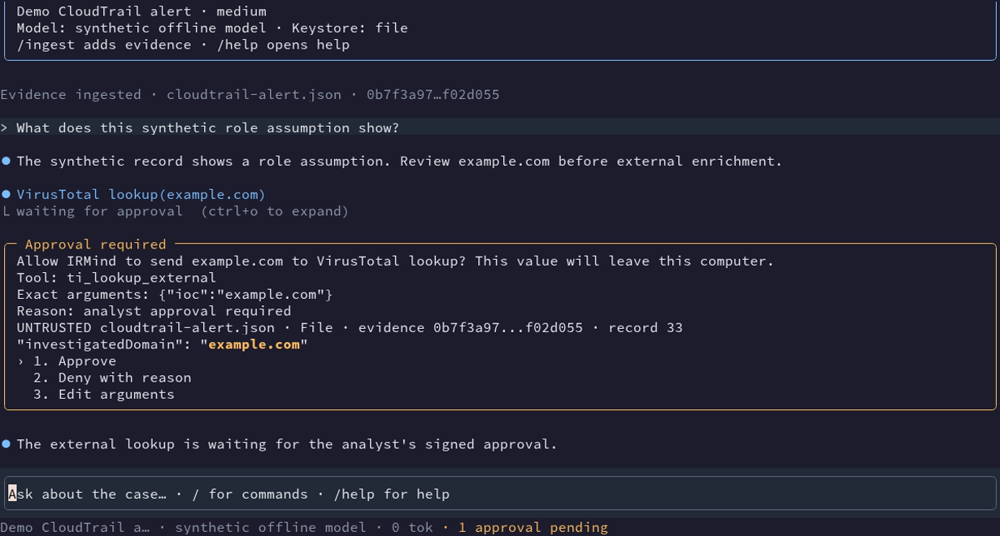
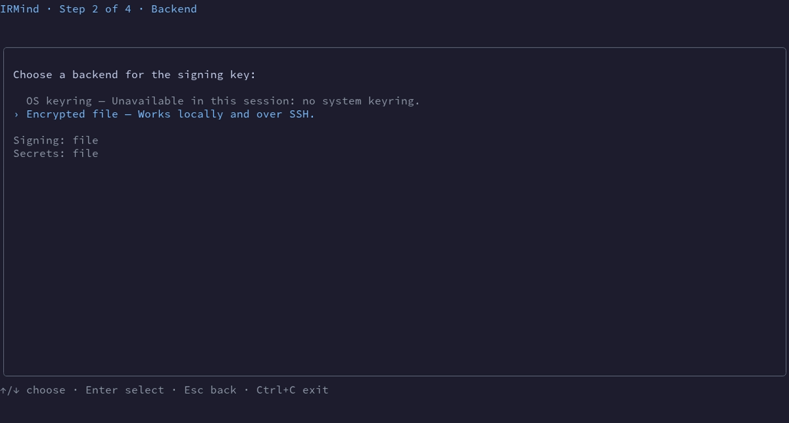
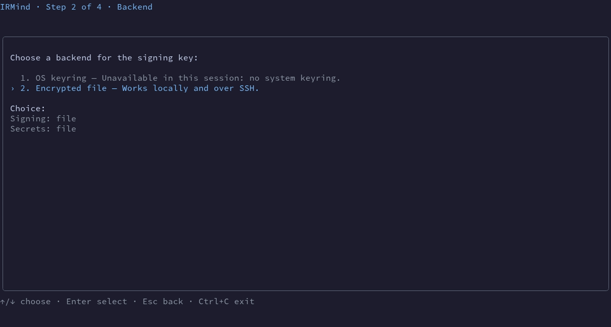

# Slash-command TUI review

These captures use only the offline synthetic demo and an ephemeral file keystore. The before images were captured from the preceding TUI; the after images use the slash-command flow in this change. No real provider, network request, local path, or production key appears.

| Screen | Before | After |
| --- | --- | --- |
| Home |  |  |
| Command menu |  |  |
| Conversation |  |  |
| Approval |  |  |
| Keystore backend |  |  |

The optional AI model setup is new: .
